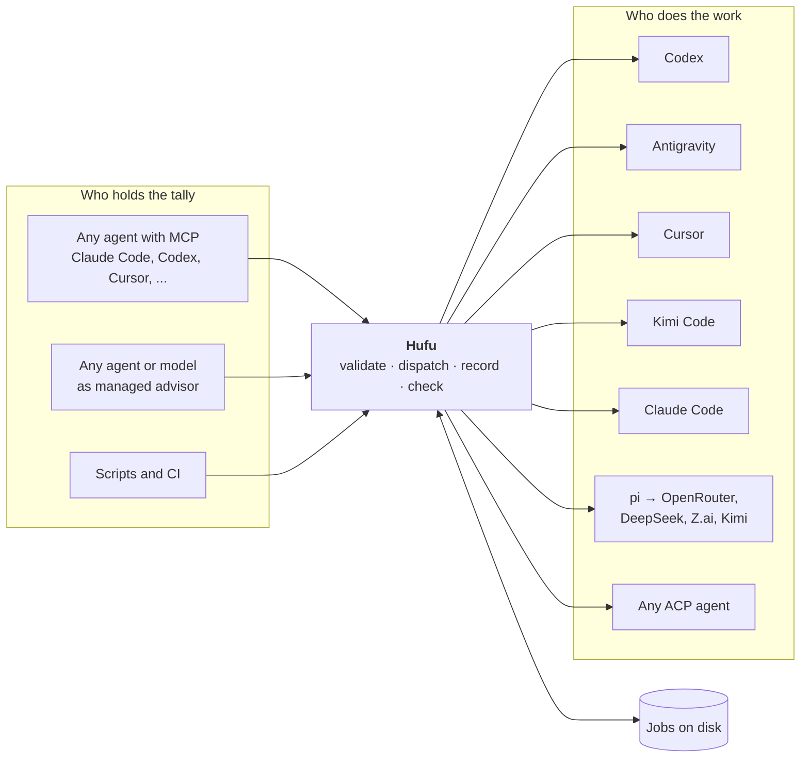

<p align="center">
  
</p>

<p align="center">
  <strong>English</strong> · <a href="README.zh-CN.md">简体中文</a>
</p>

<p align="center">
  <a href="LICENSE"></a>
  <a href="https://github.com/kverona-ai/hufu/actions/workflows/ci.yml"></a>
  <a href="doc/roadmap.md"></a>
  <a href="doc/deployment/deployment.md"></a>
  <a href="doc/adr/0007-implement-in-rust.md"></a>
</p>

# Hufu

**Hufu is a multi-agent dispatch layer with a pluggable commander.** Any coding agent or model can
act as the advisor that plans and reviews; any other agent can be dispatched to do the work. One
task spec, one set of commands and one result format, whichever agents are on either side.

> [!NOTE]
> **Status: 0.1, pre-release.** Everything described here is implemented and tested end to end on
> Linux, macOS and Windows against built-in fake agents, one per adapter. The adapters were written
> from each agent's current documentation and have **not** yet been exercised against real agent
> accounts by this project's CI, so expect first-contact issues and please report them. Releases
> are pre-releases (`0.1.0-alpha.N`) for the same reason. They come with prebuilt binaries for six
> platforms; where none can be downloaded, the installer builds from source.

## Why

Most developers now have several coding agents installed, each with its own strengths, quotas and
prices. Getting one to hand work to another is done with one-off glue, and the glue fails in the
same ways:

- **Every agent is driven differently.** Different flags, output formats and exit codes.
- **Permission defaults disagree wildly.** Run headless, one agent is read-only and the next
  approves everything. The same script is safe on one and dangerous on another.
- **Long tasks die with the session** that started them.
- **The commander is hard-wired.** Swapping the planner for a different agent means starting over.

Hufu replaces the glue with a small local scheduler: one binary, no service to run, nothing sent
anywhere except to the agents you already use.

## Install and start

### Let your agent install it

This is the main way to install Hufu. Paste this into the coding agent you already use (Claude
Code, Codex, Cursor, Kimi Code, Antigravity, or any other agent that can run commands):

```text
Install and configure Hufu on this machine. Follow the guide at
https://raw.githubusercontent.com/kverona-ai/hufu/main/doc/guide/agent-install.md
and tell me what you changed and what is left for me to do.
```

The agent checks the machine, runs the installer and `hufu up`, verifies the result with
`hufu doctor`, and reports back. What is usually left for you:

- **log in** to any agent that is not logged in yet. Hufu installs no agents and logs in for nobody,
  so you need at least one agent CLI installed and logged in;
- **restart your agent**, so that it sees Hufu's tools.

How many agents you have matters:

| Agents installed | What `hufu up` does |
|---|---|
| None | Stops before changing anything, lists how to install and log in to each supported agent, and exits with code 10. Install one, then run `hufu up` again |
| One | Sets everything up, and tells you that this agent is both the advisor and the only executor: it plans, does and reviews the work by itself. Add a second agent, or a second account of the same one, to get what Hufu is for |
| Two or more | Sets everything up. The first agent found advises, and all of them execute |

After that, configuring Hufu is a conversation with any connected agent: "add my second Codex
account and make a pool of both", "make Claude the advisor". API keys stay in your shell; Hufu
stores only the names of the variables.

The guide the agent follows is [doc/guide/agent-install.md](doc/guide/agent-install.md). An agent
that is only given this repository finds it through [AGENTS.md](AGENTS.md) and [llms.txt](llms.txt).

### Or install it by hand

```bash
# macOS and Linux
curl -fsSL https://raw.githubusercontent.com/kverona-ai/hufu/main/src/install/install.sh | sh -s -- --up
```

```powershell
# Windows (PowerShell)
$env:HUFU_UP = "1"; irm https://raw.githubusercontent.com/kverona-ai/hufu/main/src/install/install.ps1 | iex
```

The installer puts one file, `hufu`, on your machine. `--up` then runs **`hufu up`**, the one
command that sets everything up:

1. writes a first configuration from the agents it finds on your machine,
2. registers Hufu's MCP server with those agents, so that each of them can dispatch through Hufu,
3. starts the optional daemon,
4. checks the result and tells you what is still missing (for example a login).

`hufu up` asks no questions. It prints `ready` only when an agent can actually take work; with no
agent installed it stops at step 1 and says what to install.

Prefer to build it yourself? `cargo install --git https://github.com/kverona-ai/hufu hufu-cli --locked`
(Rust 1.89 or newer). More ways to install: [deployment guide](doc/deployment/deployment.md).

### Keep it up to date

```console
$ hufu update            # move to the newest release
$ hufu update --check    # only say whether there is a newer one
```

`hufu update` downloads the newest release, checks its SHA-256 sum, makes sure the new program
starts, and only then replaces the old one. It restarts the daemon if one was running and ends with
`hufu doctor`. Running jobs finish with the version they started with, and your configuration and
job records are not touched. `--version v0.2.0` installs a particular release, which is also the
way back to an older one. Or ask your agent: "update Hufu". Afterwards, restart the agents that
have Hufu connected, so that they pick up the new version.

## How it works



1. A caller submits a **task**: a prompt, an agent profile, a permission tier, an effort level and
   optional acceptance checks.
2. Hufu validates it against what that agent can really do, then launches the agent with
   **explicit** flags, in a process that does not depend on the caller.
3. Everything is recorded on disk. Any later session can ask for the status or the result.
4. A **tally check** compares the result with the task's acceptance criteria before the work
   counts as done.

## Key ideas

| | |
|---|---|
| 🐯 **Pluggable commander** | Advisor and executor are roles set in configuration, not code. The same agent can plan one mission and execute in the next |
| 📜 **One task spec** | The same YAML drives Codex, Antigravity, Cursor, Kimi Code, Claude Code, pi and any ACP agent |
| 👥 **Many executors, many accounts** | Any number of profiles, including several accounts of the same agent. Pools fail over or rotate between them |
| 💾 **Jobs outlive sessions** | State, logs and results live on disk. Lose the session, keep the work |
| 🔒 **Explicit permissions** | Three tiers, `read-only`, `workspace-write`, `full-access`, translated per agent. A tier an agent cannot honour is refused, never widened, and a read-only job that changed files is failed |
| 🎚️ **Uniform reasoning effort** | One scale mapped to each agent's own control; an unmappable level is an error, not a silent skip |
| ✅ **Tally check** | Exit code `0` is not success. Acceptance checks decide whether work is accepted |
| 🔌 **MCP in, ACP out** | Any agent that speaks MCP can drive Hufu and even configure it. Any agent that speaks ACP can be driven with a few lines of configuration |
| 🖥️ **Computer use, routed** | A task can be granted desktop control. The work goes to a dedicated operator profile or to any executor that supports it, always behind an explicit grant |
| 🦀 **One binary** | Written in Rust. A single self-contained `hufu` for Linux, macOS and Windows, with no runtime to install |

## A quick look

Hand a task to another agent and keep working:

```console
$ hufu run --agent codex --permission workspace-write --isolation worktree \
    --accept "npm test" "Refactor the token refresh logic under src/auth and keep the tests green"
j_7k2m9x4qpd

$ hufu status j_7k2m9x4qpd
$ hufu wait j_7k2m9x4qpd
$ hufu result j_7k2m9x4qpd
```

Let any model be the commander of a whole mission:

```console
$ hufu mission start --advisor claude --executors codex,kimi-acp,agy \
    "Migrate the HTTP client from callbacks to async/await; keep the tests green"
```

Describe agents once, as profiles. Several accounts of one agent are just several profiles:

```yaml
roles:
  advisor: claude                  # one advisor
  executors: [codex-any, agy]      # any number of executors: profiles or pools

profiles:
  codex:
    adapter: codex-cli
    effort: high
  codex-work:                      # a second Codex account
    adapter: codex-cli
    account: work
    home: ~/.codex-work            # that account's own login directory
  or-reasoner:                     # any OpenRouter model, through the pi harness
    adapter: pi
    provider: openrouter
    model: vendor/model-slug
    env: [OPENROUTER_API_KEY]      # the variable's name; the value stays in your shell

pools:
  codex-any:
    members: [codex, codex-work]
    strategy: failover             # or round-robin, least-busy

capabilities:
  computer_use:
    route: dedicated               # or executor: the job's own agent operates the desktop
    agent: claude                  # any profile that declares it supports computer use
```

The same can be done without opening the file (`hufu profile add`, `hufu pool add`,
`hufu config set`), or by asking any connected agent to do it through Hufu's MCP tools.

More samples: [`doc/examples/`](doc/examples/). Every command and setting: [user guide](doc/guide/user-guide.md).

## Agents

| Agent | Adapter | How Hufu drives it | Tiers |
|---|---|---|---|
| Codex (OpenAI) | `codex-cli` | `codex exec --json` | all three |
| Antigravity (Google) | `agy-cli` | `agy -p` | all three |
| Cursor | `cursor-cli` | `agent -p --output-format stream-json` | all three |
| Claude Code (Anthropic) | `claude-cli` | `claude -p --output-format stream-json` | all three |
| Kimi Code (Moonshot) | `kimi-cli` | print mode | `full-access` only |
| pi, and through it OpenRouter, DeepSeek, Z.ai, Kimi | `pi` | JSON mode | `read-only`, `full-access` |
| Cursor, Kimi Code, Gemini CLI, OpenCode, Goose, Qwen Code and other ACP agents | `acp` | Agent Client Protocol v1; Hufu answers every permission request | `full-access` until the agent is marked verified, then all three |
| Anything else | `external` | your own adapter program, a small JSON protocol | what it declares |

`hufu agents` shows this for your own configuration, and `hufu agents --probe` checks installation
and login. What each agent supports, and how sure we are of it, is recorded in the
[agent landscape](doc/research/agent-landscape.md).

## Use it from any agent

`hufu setup` registers Hufu's MCP server with Claude Code, Codex, Cursor, Kimi Code and
Antigravity (`hufu setup --agent generic --print` shows the snippet for any other host). The
connected agent then has 22 tools: dispatch and follow jobs, run missions, and read and change
Hufu's configuration, including adding profiles and pools. "Add my second Codex account to Hufu
and make a pool of both" is a sentence you can type into any of them.

An agent can also do the whole installation; that is the
[recommended way to install](#let-your-agent-install-it), and the steps it follows are in the
[agent install guide](doc/guide/agent-install.md).

## Roadmap

| Milestone | Theme | Status |
|---|---|---|
| **M0** | Foundation: requirements, research, architecture, repository layout | ✅ Done |
| **M1** | First dispatch: core, CLI, Codex and Antigravity adapters, Claude Code skill | ✅ Implemented |
| **M2** | Many agents: ACP, Cursor, Kimi Code, pi, Claude Code, third-party adapters, worktrees | ✅ Implemented |
| **M3** | Pluggable commander: missions, tally checks, budgets | ✅ Implemented |
| **M4** | Always on: daemon, limits, account pools, MCP server | ✅ Implemented |
| **M5** | Beyond the workspace: computer-use routing | ✅ Implemented |
| **Since M5** | Self-update (`hufu update`) and releases with prebuilt binaries for six platforms | ✅ Implemented |
| **Next** | Verification against real agent accounts, first stable release | ⚪ Open |

Details: [doc/roadmap.md](doc/roadmap.md).

## Documentation

| Document | What it covers |
|---|---|
| [Agent install guide](doc/guide/agent-install.md) | The steps an agent follows to install, set up, configure and check Hufu for you |
| [User guide](doc/guide/user-guide.md) | Every command, the configuration reference, the MCP tools, recipes |
| [Requirements](doc/requirements/requirements.md) | Goals, users, scenarios, functional and non-functional requirements |
| [Agent landscape](doc/research/agent-landscape.md) | How each agent can be driven headlessly; the Agent Client Protocol |
| [Prior art and naming](doc/research/prior-art.md) | Existing orchestrators and where Hufu differs |
| [Computer use study](doc/research/computer-use.md) | What Hufu learns from LCU for routing computer use |
| [Architecture](doc/architecture/architecture.md) | Components, roles, job and mission lifecycles, security model |
| [Technical design](doc/technical/technical-design.md) | Crates, configuration, task spec, job store, missions, testing |
| [Adapter contract](doc/technical/adapter-contract.md) | Adapter interface; permission and effort mapping per agent |
| [Deployment](doc/deployment/deployment.md) | Install, configure, connect hosts, operate, release |
| [Cloud environment](doc/deployment/cloud-environment.md) | What cloud development sessions need |
| [Decision records](doc/adr/README.md) | Why the design is the way it is |

Full index: [doc/README.md](doc/README.md).

## Repository layout

```text
hufu/
├── README.md            this file
├── README.zh-CN.md      Chinese version
├── AGENTS.md            where an agent should go: install, use, or change the code
├── llms.txt             the same as an index of links, for agents and crawlers
├── CONTRIBUTING.md
├── LICENSE              Apache-2.0
├── .github/workflows/   CI on Linux, macOS and Windows; the release workflow
├── doc/                 every document: requirements, research, architecture,
│                        technical design, user guide, deployment, decision records, examples
└── src/                 every line of code: a Cargo workspace with its tests,
                         the install scripts and the agent integrations
```

## The name

A *hufu* (虎符, tiger tally) was the token that authorised troop movements in ancient China. It was
cast in two halves: the ruler kept one, the commander in the field held the other, and an order was
valid only when the halves were brought together and matched.

Hufu the project borrows both ideas. **Whoever holds the tally commands**: the advisor is a role,
not a fixed program. And **work counts only when the halves match**: a task's spec and its result
are checked against each other before anything is accepted.

## Contributing

Reports from runs against real agents are the most useful contribution right now. See
[CONTRIBUTING.md](CONTRIBUTING.md).

## License

[Apache License 2.0](LICENSE)
