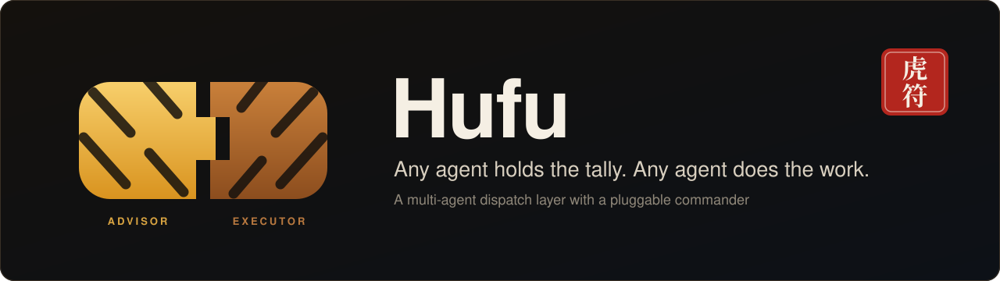
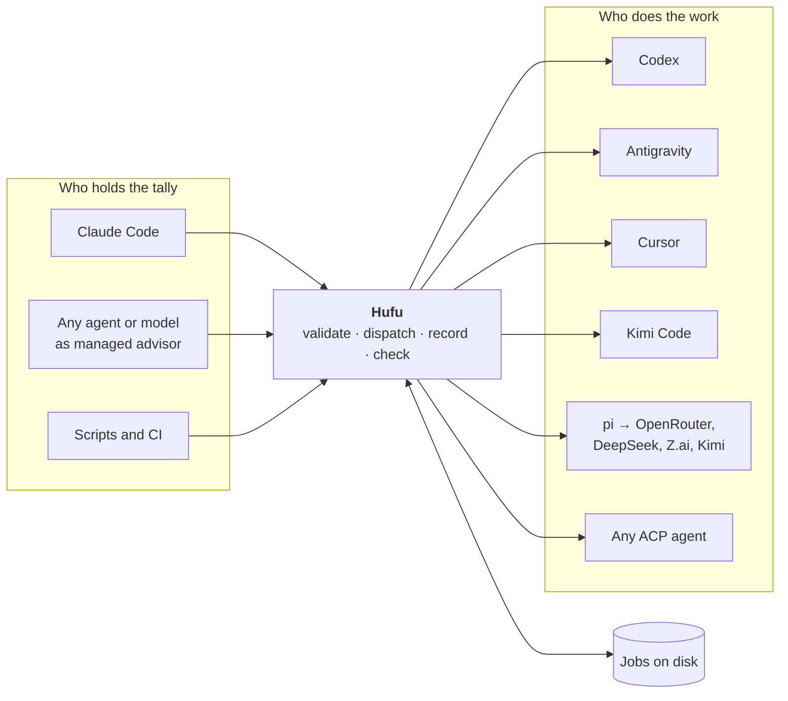

<p align="center">
  
</p>

<p align="center">
  <strong>English</strong> · <a href="README.zh-CN.md">简体中文</a>
</p>

<p align="center">
  <a href="LICENSE"></a>
  <a href="doc/roadmap.md"></a>
  
  <a href="doc/research/agent-landscape.md"></a>
  <a href="CONTRIBUTING.md"></a>
</p>

# Hufu

**Hufu is a multi-agent dispatch layer with a pluggable commander.** Any coding agent or model can
act as the advisor that plans and reviews; any other agent can be dispatched to do the work. One
task spec, one set of commands and one result format, whichever agents are on either side.

> [!NOTE]
> **Hufu is in its design phase.** This repository currently holds the requirements, research,
> architecture and technical design. There is no release yet, and the commands shown below describe
> the planned interface. See the [roadmap](doc/roadmap.md) for what is built when.

## Why

Most developers now have several coding agents installed, each with its own strengths, quotas and
prices. Getting one to hand work to another is done with one-off glue, and the glue fails in the
same ways:

- **Every agent is driven differently.** Different flags, output formats and exit codes.
- **Permission defaults disagree wildly.** Run headless, one agent is read-only and the next
  approves everything. The same script is safe on one and dangerous on another.
- **Long tasks die with the session** that started them.
- **The commander is hard-wired.** Swapping the planner for a different agent means starting over.

Hufu replaces the glue with a small local scheduler.

## How it works



1. A caller submits a **task**: a prompt, an agent profile, a permission tier, an effort level and
   optional acceptance checks.
2. Hufu validates it against what that agent can really do, then launches the agent with
   **explicit** flags, in a process that does not depend on the caller.
3. Everything is recorded on disk. Any later session can ask for the status or the result.
4. A **tally check** compares the result with the task's acceptance criteria before the work
   counts as done.

## Key ideas

| | |
|---|---|
| 🐯 **Pluggable commander** | Advisor and executor are roles set in configuration, not code. The same agent can plan one mission and execute in the next |
| 📜 **One task spec** | The same YAML drives Codex, Cursor, Antigravity, Kimi Code, pi and any ACP agent |
| 💾 **Jobs outlive sessions** | State, logs and results live on disk. Lose the session, keep the work |
| 🔒 **Explicit permissions** | Three tiers, `read-only`, `workspace-write`, `full-access`, translated per agent. A tier an agent cannot honour is refused, never widened |
| 🎚️ **Uniform reasoning effort** | One scale mapped to each agent's own control; an unmappable level is an error, not a silent skip |
| ✅ **Tally check** | Exit code `0` is not success. Acceptance checks decide whether work is accepted |
| 🌐 **Open-API models** | Any model on OpenRouter, DeepSeek, Z.ai or Kimi's coding plan becomes an agent through the pi harness |
| 🔌 **ACP first** | A new Agent Client Protocol agent is added with a few lines of configuration |

## A quick look

> Planned interface. Not yet available.

Hand a task to another agent and keep working:

```bash
$ hufu run --agent codex-high --permission workspace-write --isolation worktree \
    "Refactor the token refresh logic under src/auth and run the unit tests"
j_7k2m9x4qpd

$ hufu status j_7k2m9x4qpd
j_7k2m9x4qpd  running  codex-high  4m12s  editing src/auth/refresh.ts

$ hufu result j_7k2m9x4qpd
succeeded · accepted · 5m12s · branch hufu/j_7k2m9x4qpd
Refactored refresh() to share one in-flight promise. 14 tests pass.
changed: src/auth/refresh.ts, test/auth/refresh.test.ts
```

Let any model be the commander:

```bash
$ hufu mission start --advisor or-reasoner --executors codex-high,kimi,agy-fast \
    "Migrate the HTTP client from callbacks to async/await; keep the tests green"
```

Describe agents once, as profiles:

```yaml
profiles:
  codex-high:
    adapter: codex-cli
    effort: high
  kimi:
    adapter: acp
    command: [kimi, acp]
  or-reasoner:                 # any OpenRouter model, through the pi harness
    adapter: pi
    provider: openrouter
    model: vendor/model-slug
    env: [OPENROUTER_API_KEY]
```

More samples: [`doc/examples/`](doc/examples/).

## Agents

| Agent | How Hufu drives it | Planned |
|---|---|---|
| Codex (OpenAI) | Headless CLI, `codex exec` | M1 |
| Antigravity (Google) | Headless CLI, `agy -p` | M1 |
| Cursor | ACP (`agent acp`) or headless CLI | M2 |
| Kimi Code (Moonshot) | ACP (`kimi acp`) | M2 |
| pi, and through it OpenRouter, DeepSeek, Z.ai, Kimi | pi JSON / RPC mode | M2 |
| Claude Code (Anthropic) | Headless CLI or ACP adapter | M2 |
| Gemini CLI, OpenCode, Goose, Qwen Code and other ACP agents | Generic ACP adapter, configuration only | M2 |

What each agent supports, and how sure we are of it, is recorded in the
[agent landscape](doc/research/agent-landscape.md).

## Roadmap

| Milestone | Theme | Status |
|---|---|---|
| **M0** | Foundation: requirements, research, architecture, repository layout | 🟡 In progress |
| **M1** | First dispatch: core, CLI, Codex and Antigravity adapters, Claude Code skill | ⚪ Planned |
| **M2** | Many agents: generic ACP adapter, pi, git worktree isolation | ⚪ Planned |
| **M3** | Pluggable commander: missions, tally checks, budgets | ⚪ Planned |
| **M4** | Always on: daemon, quotas, MCP server | ⚪ Planned |

Details: [doc/roadmap.md](doc/roadmap.md).

## Documentation

| Document | What it covers |
|---|---|
| [Requirements](doc/requirements/requirements.md) | Goals, users, scenarios, functional and non-functional requirements |
| [Agent landscape](doc/research/agent-landscape.md) | How each agent can be driven headlessly; the Agent Client Protocol |
| [Prior art and naming](doc/research/prior-art.md) | Existing orchestrators and where Hufu differs |
| [Architecture](doc/architecture/architecture.md) | Components, roles, job and mission lifecycles, security model |
| [Technical design](doc/technical/technical-design.md) | Stack, configuration, task spec, CLI, job store, missions, testing |
| [Adapter contract](doc/technical/adapter-contract.md) | Adapter interface; permission and effort mapping per agent |
| [Deployment](doc/deployment/deployment.md) | Install, configure, connect hosts, operate |
| [Cloud environment](doc/deployment/cloud-environment.md) | What cloud development sessions need |
| [Decision records](doc/adr/README.md) | Why the design is the way it is |

Full index: [doc/README.md](doc/README.md).

## Repository layout

```text
hufu/
├── README.md            this file
├── README.zh-CN.md      Chinese version
├── CONTRIBUTING.md
├── LICENSE              Apache-2.0
├── doc/                 every document: requirements, research, architecture,
│                        technical design, deployment, decision records, examples
└── src/                 every line of code, with its manifest and tests (from M1)
```

## The name

A *hufu* (虎符, tiger tally) was the token that authorised troop movements in ancient China. It was
cast in two halves: the ruler kept one, the commander in the field held the other, and an order was
valid only when the halves were brought together and matched.

Hufu the project borrows both ideas. **Whoever holds the tally commands**: the advisor is a role,
not a fixed program. And **work counts only when the halves match**: a task's spec and its result
are checked against each other before anything is accepted.

## Contributing

Feedback on the design is the most useful contribution right now. See
[CONTRIBUTING.md](CONTRIBUTING.md).

## License

[Apache License 2.0](LICENSE)
