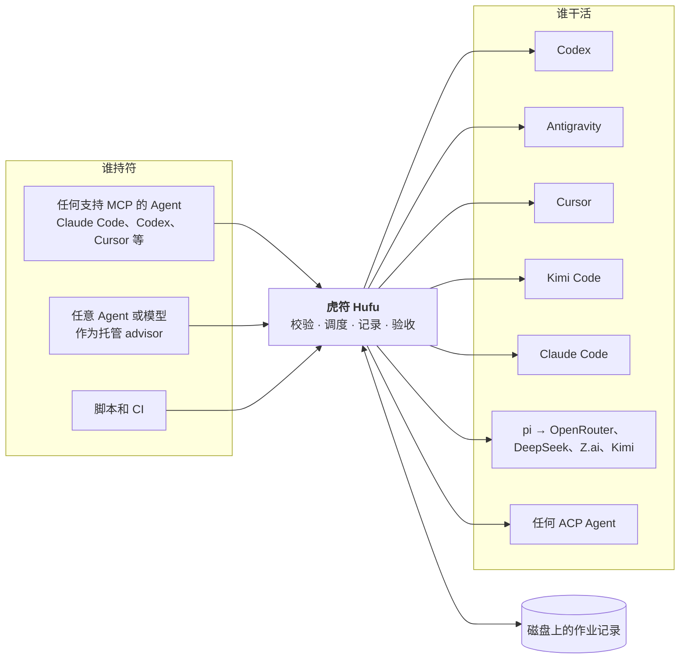

<p align="center">
  
</p>

<p align="center">
  <a href="README.md">English</a> · <strong>简体中文</strong>
</p>

<p align="center">
  <a href="LICENSE"></a>
  <a href="https://github.com/kverona-ai/hufu/actions/workflows/ci.yml"></a>
  <a href="doc/roadmap.md"></a>
  <a href="doc/deployment/deployment.md"></a>
  <a href="doc/adr/0007-implement-in-rust.md"></a>
</p>

# Hufu 虎符

**虎符（Hufu）是可插拔指挥者的多 Agent 调度层。** 任意编码 Agent 或模型都可以充当负责规划和验收的
advisor，任意其他 Agent 都可以被派去执行任务。无论两端是哪些 Agent，用的都是同一份任务规格、同一组
命令和同一种结果格式。

> [!NOTE]
> **当前状态：0.1 预发布。** 本文描述的功能都已实现，并在 Linux、macOS、Windows 三个平台上用内置的
> 模拟 Agent（每种适配器一个）做了端到端测试。各适配器是按各 Agent 的最新文档编写的，本项目的 CI
> **还没有**用真实账号跑过，首次对接真实 Agent 时可能遇到问题，欢迎反馈。目前还没有打过发布标签，
> 在此之前安装脚本会从源码构建。

## 为什么要做

现在多数开发者都同时装着好几个编码 Agent，它们各有所长，额度和价格也不一样。想让其中一个把活交给
另一个，目前只能靠一次性的胶水脚本，而这些胶水总是在同样的地方出问题：

- **每个 Agent 的驱动方式都不一样。** 参数、输出格式、退出码各不相同。
- **权限默认值差别极大。** 同样是无人值守运行，有的 Agent 默认只读，有的默认全部放行。同一段脚本
  换一个 Agent 就可能从安全变成危险。
- **长任务会跟着发起它的会话一起消失。**
- **指挥者是写死的。** 想换一个 Agent 来做规划，就得从头再来。

虎符用一个小型的本地调度器取代这些胶水：只有一个可执行文件，不需要常驻服务，除了你本来就在用的
Agent 之外不向任何地方发送数据。

## 安装和启动

```bash
# macOS 和 Linux
curl -fsSL https://raw.githubusercontent.com/kverona-ai/hufu/main/src/install/install.sh | sh -s -- --up
```

```powershell
# Windows（PowerShell）
$env:HUFU_UP = "1"; irm https://raw.githubusercontent.com/kverona-ai/hufu/main/src/install/install.ps1 | iex
```

安装脚本只往机器上放一个文件 `hufu`。带上 `--up` 后会接着执行 **`hufu up`**，一条命令完成全部配置：

1. 检测本机装了哪些 Agent，据此写出第一份配置；
2. 把虎符的 MCP 服务注册到这些 Agent 里，让它们都能通过虎符派活；
3. 启动可选的守护进程；
4. 做一遍检查，告诉你还缺什么（比如某个 Agent 还没登录）。

想自己编译：`cargo install --git https://github.com/kverona-ai/hufu hufu-cli --locked`（需要 Rust 1.89
或更新版本）。更多安装方式见[部署文档](doc/deployment/deployment.md)。

## 工作方式



1. 调用方提交一个**任务**：提示词、Agent 配置（profile）、权限档位、思考强度，以及可选的验收条件。
2. 虎符先按该 Agent 的真实能力做校验，再用**显式**参数启动它，运行它的进程不依赖调用方。
3. 所有过程都记录在磁盘上，之后任何会话都能查询状态、取回结果。
4. **合符检查**把结果和任务的验收条件对一遍，通过了工作才算完成。

## 核心设计

| | |
|---|---|
| 🐯 **可插拔的指挥者** | advisor 和执行者是配置里的角色，不是写死的代码。同一个 Agent 这次做规划，下次可以去执行 |
| 📜 **统一的任务规格** | 同一份 YAML 可以驱动 Codex、Antigravity、Cursor、Kimi Code、Claude Code、pi 和任何 ACP Agent |
| 👥 **多个执行者，多个账号** | 可以配置任意多个 profile，包括同一个 Agent 的多个账号。账号池可以故障切换或轮流使用 |
| 💾 **作业不随会话消失** | 状态、日志和结果都在磁盘上。会话丢了，工作还在 |
| 🔒 **显式的权限** | 三个档位：`read-only`、`workspace-write`、`full-access`，按 Agent 逐一翻译。Agent 做不到的档位直接拒绝，绝不悄悄放宽；只读作业如果改了文件，直接判失败 |
| 🎚️ **统一的思考强度** | 一套刻度映射到各 Agent 自己的控制方式；映射不了就报错，而不是悄悄忽略 |
| ✅ **合符检查** | 退出码为 `0` 不等于成功。工作是否被接受由验收条件决定 |
| 🔌 **MCP 接入，ACP 接出** | 任何支持 MCP 的 Agent 都能驱动虎符，甚至替你配置虎符。任何支持 ACP 的 Agent 写几行配置就能被驱动 |
| 🖥️ **可路由的 computer use** | 任务可以被授予操作桌面应用的权限。具体由谁来操作可以配置：单独的操作者 profile，或任何支持 computer use 的执行者。必须有显式授权 |
| 🦀 **单一可执行文件** | 使用 Rust 编写。Linux、macOS、Windows 上都只有一个自包含的 `hufu`，不需要安装运行时 |

## 快速预览

把任务交给另一个 Agent，自己继续干别的：

```console
$ hufu run --agent codex --permission workspace-write --isolation worktree \
    --accept "npm test" "重构 src/auth 下的 token 刷新逻辑，并保持测试通过"
j_7k2m9x4qpd

$ hufu status j_7k2m9x4qpd
$ hufu wait j_7k2m9x4qpd
$ hufu result j_7k2m9x4qpd
```

让任意模型来指挥一整个 mission：

```console
$ hufu mission start --advisor claude --executors codex,kimi-acp,agy \
    "把 HTTP 客户端从回调风格迁移到 async/await，保持测试通过"
```

Agent 只需要描述一次，写成 profile。同一个 Agent 的多个账号就是多个 profile：

```yaml
roles:
  advisor: claude                  # advisor 配一个
  executors: [codex-any, agy]      # 执行者可以有任意多个：profile 或账号池

profiles:
  codex:
    adapter: codex-cli
    effort: high
  codex-work:                      # 第二个 Codex 账号
    adapter: codex-cli
    account: work
    home: ~/.codex-work            # 这个账号自己的登录目录
  or-reasoner:                     # 通过 pi 接入 OpenRouter 上的任意模型
    adapter: pi
    provider: openrouter
    model: vendor/model-slug
    env: [OPENROUTER_API_KEY]      # 只写变量名，值留在你的 shell 里

pools:
  codex-any:
    members: [codex, codex-work]
    strategy: failover             # 也可以是 round-robin、least-busy

capabilities:
  computer_use:
    route: dedicated               # 或 executor：由作业自己的 Agent 操作桌面
    agent: claude                  # 任何声明了支持 computer use 的 profile
```

这些都可以不打开文件来完成（`hufu profile add`、`hufu pool add`、`hufu config set`），也可以直接
让任何已接入的 Agent 通过虎符的 MCP 工具替你配置。

更多示例见 [`doc/examples/`](doc/examples/)。全部命令和配置项见[用户指南](doc/guide/user-guide.md)。

## 支持的 Agent

| Agent | 适配器 | 虎符的驱动方式 | 支持的档位 |
|---|---|---|---|
| Codex（OpenAI） | `codex-cli` | `codex exec --json` | 全部三档 |
| Antigravity（Google） | `agy-cli` | `agy -p` | 全部三档 |
| Cursor | `cursor-cli` | `agent -p --output-format stream-json` | 全部三档 |
| Claude Code（Anthropic） | `claude-cli` | `claude -p --output-format stream-json` | 全部三档 |
| Kimi Code（Moonshot） | `kimi-cli` | print 模式 | 仅 `full-access` |
| pi，以及通过它接入的 OpenRouter、DeepSeek、Z.ai、Kimi | `pi` | JSON 模式 | `read-only`、`full-access` |
| Cursor、Kimi Code、Gemini CLI、OpenCode、Goose、Qwen Code 等 ACP Agent | `acp` | Agent Client Protocol v1，每一次权限请求都由虎符回答 | 标记为已核实之前只有 `full-access`，之后全部三档 |
| 其他任何程序 | `external` | 你自己写的适配器程序，走一个很小的 JSON 协议 | 由它自己声明 |

`hufu agents` 会按你自己的配置列出这张表，`hufu agents --probe` 还会检查是否已安装、已登录。每个
Agent 支持什么、我们对此有多大把握，记录在 [Agent 调研](doc/research/agent-landscape.md)里。

## 在任何 Agent 里使用

`hufu setup` 会把虎符的 MCP 服务注册到 Claude Code、Codex、Cursor、Kimi Code 和 Antigravity
（其他宿主可以用 `hufu setup --agent generic --print` 拿到配置片段）。接入后的 Agent 会多出 22 个
工具：派发和跟踪作业、运行 mission，以及读取和修改虎符的配置，包括添加 profile 和账号池。
"把我的第二个 Codex 账号加进虎符，和现有的组成一个池"这样的话，可以直接对其中任何一个 Agent 说。

## 路线图

| 里程碑 | 主题 | 状态 |
|---|---|---|
| **M0** | 打基础：需求、调研、架构、仓库结构 | ✅ 完成 |
| **M1** | 第一次调度：核心、命令行、Codex 和 Antigravity 适配器、Claude Code skill | ✅ 已实现 |
| **M2** | 接入更多 Agent：ACP、Cursor、Kimi Code、pi、Claude Code、第三方适配器、worktree | ✅ 已实现 |
| **M3** | 可插拔的指挥者：mission、合符检查、预算 | ✅ 已实现 |
| **M4** | 常驻运行：守护进程、并发限制、账号池、MCP 服务 | ✅ 已实现 |
| **M5** | 工作区之外：computer use 路由 | ✅ 已实现 |
| **下一步** | 用真实 Agent 账号做验证，打第一个发布标签 | ⚪ 待办 |

详见 [doc/roadmap.md](doc/roadmap.md)。

## 文档

文档正文为英文。

| 文档 | 内容 |
|---|---|
| [用户指南](doc/guide/user-guide.md) | 全部命令、配置参考、MCP 工具、常见用法 |
| [需求](doc/requirements/requirements.md) | 目标、用户、场景、功能性和非功能性需求 |
| [Agent 调研](doc/research/agent-landscape.md) | 各 Agent 如何无人值守地驱动；Agent Client Protocol |
| [同类项目与命名](doc/research/prior-art.md) | 现有的编排工具，以及虎符的不同之处 |
| [computer use 调研](doc/research/computer-use.md) | 虎符从 LCU 项目借鉴了什么 |
| [架构](doc/architecture/architecture.md) | 组件、角色、作业和 mission 的生命周期、安全模型 |
| [技术设计](doc/technical/technical-design.md) | crate 划分、配置、任务规格、作业存储、mission、测试 |
| [适配器契约](doc/technical/adapter-contract.md) | 适配器接口；各 Agent 的权限和思考强度映射 |
| [部署](doc/deployment/deployment.md) | 安装、配置、接入宿主、运维、发布 |
| [云端环境](doc/deployment/cloud-environment.md) | 云端开发会话需要什么 |
| [决策记录](doc/adr/README.md) | 设计为什么是现在这样 |

完整索引：[doc/README.md](doc/README.md)。

## 仓库结构

```text
hufu/
├── README.md            英文说明
├── README.zh-CN.md      本文件
├── CONTRIBUTING.md
├── LICENSE              Apache-2.0
├── .github/workflows/   Linux、macOS、Windows 三平台 CI；发布构建
├── doc/                 所有文档：需求、调研、架构、技术设计、用户指南、部署、决策记录、示例
└── src/                 所有代码：Cargo workspace 及其测试、安装脚本、各 Agent 的集成文件
```

## 名字的由来

虎符是古代调兵的凭证，铸成两半：君主持一半，在外的将领持另一半，两半合上、对得上，军令才算数。

这个项目借用了其中两层意思。**谁持符谁调兵**：advisor 是一个角色，而不是某个固定的程序。
**合符才算数**：任务规格和执行结果要对得上，工作才会被接受。

## 参与贡献

现阶段最有价值的贡献是用真实 Agent 跑一跑并反馈结果，详见 [CONTRIBUTING.md](CONTRIBUTING.md)。

## 许可证

[Apache License 2.0](LICENSE)
