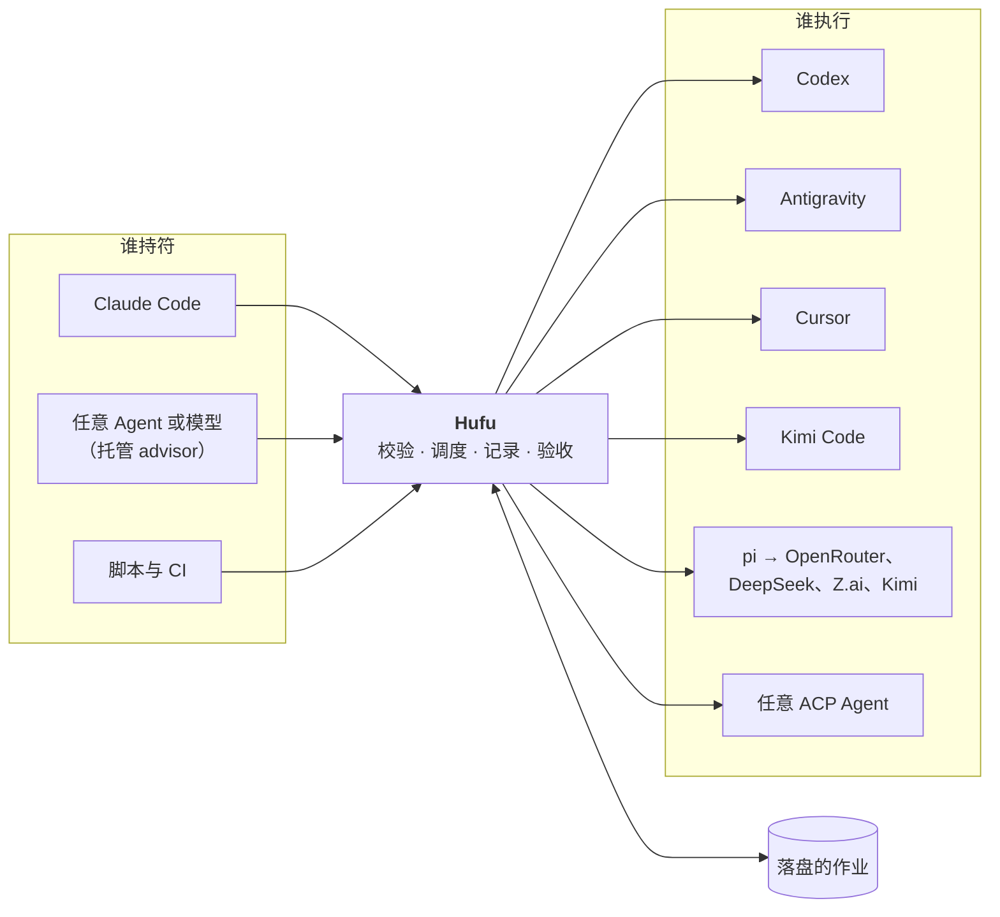

<p align="center">
  
</p>

<p align="center">
  <a href="README.md">English</a> · <strong>简体中文</strong>
</p>

<p align="center">
  <a href="LICENSE"></a>
  <a href="doc/roadmap.md"></a>
  <a href="doc/adr/0007-implement-in-rust.md"></a>
  <a href="doc/research/agent-landscape.md"></a>
  <a href="CONTRIBUTING.md"></a>
</p>

# Hufu 虎符

**虎符（Hufu）是可插拔指挥者的多 Agent 调度层。** 任意编码 Agent 或模型都可以充当负责规划和验收的
advisor，任意其他 Agent 都可以被派去执行任务。无论两端是哪些 Agent，用的都是同一份任务规格、同一组
命令和同一种结果格式。

> [!NOTE]
> **项目目前处于设计阶段。** 仓库里现在是需求、调研、架构和技术设计文档，还没有发布版本，下文出现的
> 命令描述的是规划中的接口。各阶段的交付内容见[路线图](doc/roadmap.md)。

## 为什么要做

现在多数开发者都同时装着好几个编码 Agent，它们各有所长，额度和价格也不一样。想让其中一个把活交给
另一个，目前只能靠一次性的胶水脚本，而这些胶水总是在同样的地方出问题：

- **每个 Agent 的调用方式都不同。** 参数、输出格式、退出码各不相同。
- **权限默认值天差地别。** 同样是无头运行，有的默认只读，有的默认全部放行。同一段脚本在这个 Agent
  上是安全的，换一个就很危险。
- **长任务随会话一起消失。** 发起任务的会话一断，任务就丢了。
- **指挥者是写死的。** 想换一个 Agent 来做规划，就得从头再来。

Hufu 用一个轻量的本地调度器取代这些胶水。

## 工作方式



1. 调用方提交一个**任务**：提示词、Agent 配置档、权限档位、推理强度，以及可选的验收检查。
2. Hufu 先按该 Agent 的真实能力校验任务，再用**显式**参数启动 Agent。执行进程不依赖调用方。
3. 所有内容都记录在磁盘上，之后任何会话都可以查询状态或取回结果。
4. **合符检查**把结果和任务的验收标准对一遍，通过了才算完成。

## 核心设计

| | |
|---|---|
| 🐯 **可插拔的指挥者** | advisor 和执行者是配置里的角色，不是写死的代码。同一个 Agent 这次负责规划，下次可以去执行 |
| 📜 **一份任务规格** | 同一份 YAML 可以驱动 Codex、Cursor、Antigravity、Kimi Code、pi 和任意 ACP Agent |
| 💾 **作业比会话活得久** | 状态、日志和结果都在磁盘上。会话断了，工作还在 |
| 🔒 **权限必须显式** | 三个档位 `read-only`、`workspace-write`、`full-access`，由适配器翻译成各家参数。Agent 做不到的档位直接拒绝，绝不放宽 |
| 🎚️ **统一的推理强度** | 一套档位映射到各 Agent 自己的参数。映射不了就报错，不会悄悄忽略 |
| ✅ **合符检查** | 退出码为 `0` 不等于成功，由验收检查决定工作是否被接受 |
| 🌐 **开放 API 模型** | OpenRouter、DeepSeek、Z.ai、Kimi 编码套餐上的任意模型，套上 pi 就是一个 Agent |
| 🔌 **优先走 ACP** | 新增一个支持 Agent Client Protocol 的 Agent，只需要几行配置 |
| 🦀 **单个二进制** | 用 Rust 编写，只有一个自包含的 `hufu` 命令，不需要安装任何运行时 |
| 🖥️ **可路由的 computer use**（规划中） | 任务可以通过专门的操作 Agent 或执行者自己的 Agent 使用桌面，由配置决定，并且必须显式授权 |

## 快速预览

> 以下为规划中的接口，目前尚不可用。

把任务交给另一个 Agent，自己继续干活：

```bash
$ hufu run --agent codex-high --permission workspace-write --isolation worktree \
    "重构 src/auth 下的 token 刷新逻辑并跑通单测"
j_7k2m9x4qpd

$ hufu status j_7k2m9x4qpd
j_7k2m9x4qpd  running  codex-high  4m12s  editing src/auth/refresh.ts

$ hufu result j_7k2m9x4qpd
succeeded · accepted · 5m12s · branch hufu/j_7k2m9x4qpd
Refactored refresh() to share one in-flight promise. 14 tests pass.
changed: src/auth/refresh.ts, test/auth/refresh.test.ts
```

让任意模型来当指挥者：

```bash
$ hufu mission start --advisor or-reasoner --executors codex-high,kimi,agy-fast \
    "把 HTTP 客户端从回调改成 async/await，保持测试全绿"
```

Agent 只需要以配置档的形式描述一次：

```yaml
profiles:
  codex-high:
    adapter: codex-cli
    effort: high
  kimi:
    adapter: acp
    command: [kimi, acp]
  or-reasoner:                 # OpenRouter 上的任意模型，通过 pi 接入
    adapter: pi
    provider: openrouter
    model: vendor/model-slug
    env: [OPENROUTER_API_KEY]
```

更多示例见 [`doc/examples/`](doc/examples/)。

## 支持的 Agent

| Agent | Hufu 的驱动方式 | 计划阶段 |
|---|---|---|
| Codex（OpenAI） | 无头 CLI，`codex exec` | M1 |
| Antigravity（Google） | 无头 CLI，`agy -p` | M1 |
| Cursor | ACP（`agent acp`）或无头 CLI | M2 |
| Kimi Code（Moonshot） | ACP（`kimi acp`） | M2 |
| pi，以及经由它接入的 OpenRouter、DeepSeek、Z.ai、Kimi | pi 的 JSON / RPC 模式 | M2 |
| Claude Code（Anthropic） | 无头 CLI 或 ACP 适配器 | M2 |
| Gemini CLI、OpenCode、Goose、Qwen Code 等 ACP Agent | 通用 ACP 适配器，只需配置 | M2 |

每个 Agent 支持什么、我们对这些结论有多大把握，记录在
[Agent 调研](doc/research/agent-landscape.md)里。

## 路线图

| 阶段 | 主题 | 状态 |
|---|---|---|
| **M0** | 打地基：需求、调研、架构、仓库结构 | 🟡 进行中 |
| **M1** | 第一次调度：核心、CLI、Codex 和 Antigravity 两个适配器、Claude Code skill | ⚪ 计划中 |
| **M2** | 接入更多 Agent：通用 ACP 适配器、pi、git worktree 隔离 | ⚪ 计划中 |
| **M3** | 可插拔指挥者：mission、合符检查、预算 | ⚪ 计划中 |
| **M4** | 常驻运行：守护进程、并发配额、MCP 服务 | ⚪ 计划中 |
| **M5** | 走出工作区：computer use 能力路由 | ⚪ 计划中 |

详见 [doc/roadmap.md](doc/roadmap.md)。

## 文档

文档正文为英文。

| 文档 | 内容 |
|---|---|
| [需求](doc/requirements/requirements.md) | 目标、用户、场景、功能性与非功能性需求 |
| [Agent 调研](doc/research/agent-landscape.md) | 各 Agent 的无头调用方式；Agent Client Protocol |
| [同类项目与命名](doc/research/prior-art.md) | 已有的编排器，以及 Hufu 的差异 |
| [computer use 调研](doc/research/computer-use.md) | 从 LCU 项目中借鉴的 computer use 路由设计 |
| [架构](doc/architecture/architecture.md) | 组件、角色、作业与 mission 的生命周期、安全模型 |
| [技术设计](doc/technical/technical-design.md) | Rust 技术栈与 crate 结构、配置、任务规格、CLI、作业存储、mission、测试 |
| [适配器契约](doc/technical/adapter-contract.md) | 适配器接口；各 Agent 的权限与推理强度映射 |
| [部署](doc/deployment/deployment.md) | 安装、配置、接入宿主、运维 |
| [云端开发环境](doc/deployment/cloud-environment.md) | 云端开发会话需要的环境配置 |
| [决策记录](doc/adr/README.md) | 设计为什么是现在这样 |

完整索引见 [doc/README.md](doc/README.md)。

## 仓库结构

```text
hufu/
├── README.md            英文说明
├── README.zh-CN.md      本文件
├── CONTRIBUTING.md
├── LICENSE              Apache-2.0
├── doc/                 所有文档：需求、调研、架构、技术设计、部署、决策记录、示例
└── src/                 所有代码：一个 Cargo workspace，连同测试（从 M1 开始）
```

## 名字的由来

虎符是古代调兵的凭证，铸成两半：君主持一半，在外的将领持另一半，两半合上、对得上，军令才算数。

这个项目借用了其中两层意思。**谁持符谁调兵**：advisor 是一个角色，而不是某个固定的程序。
**合符才算数**：任务规格和执行结果要对得上，工作才会被接受。

## 参与贡献

现阶段最有价值的贡献是对设计提出意见，详见 [CONTRIBUTING.md](CONTRIBUTING.md)。

## 许可证

[Apache License 2.0](LICENSE)
