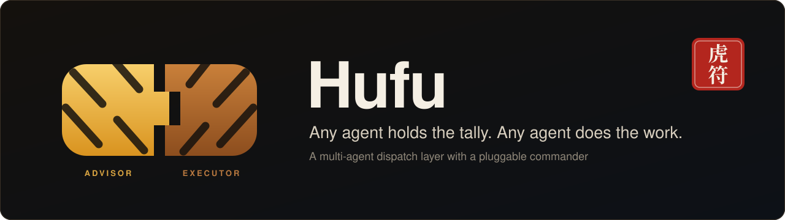
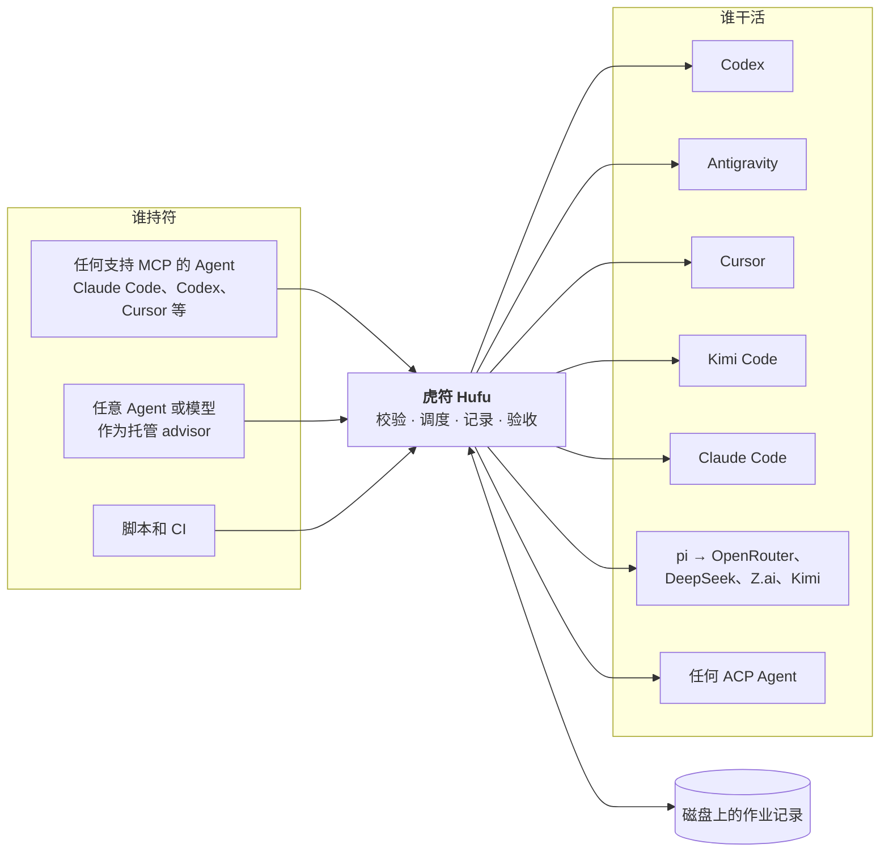

<p align="center">
  
</p>

<p align="center">
  <a href="README.md">English</a> · <strong>简体中文</strong>
</p>

<p align="center">
  <a href="LICENSE"></a>
  <a href="https://github.com/kverona-ai/hufu/actions/workflows/ci.yml"></a>
  <a href="doc/roadmap.md"></a>
  <a href="doc/deployment/deployment.md"></a>
  <a href="doc/adr/0007-implement-in-rust.md"></a>
</p>

# Hufu 虎符

**虎符（Hufu）是可插拔指挥者的多 Agent 调度层。** 任意编码 Agent 或模型都可以充当负责规划和验收的
advisor，任意其他 Agent 都可以被派去执行任务。无论两端是哪些 Agent，用的都是同一份任务规格、同一组
命令和同一种结果格式。

> [!NOTE]
> **当前状态：0.1 预发布。** 本文描述的功能都已实现，并在 Linux、macOS、Windows 三个平台上用内置的
> 模拟 Agent（每种适配器一个）做了端到端测试。各适配器是按各 Agent 的最新文档编写的，本项目的 CI
> **还没有**用真实账号跑过，首次对接真实 Agent 时可能遇到问题，欢迎反馈。出于同样的原因，目前发布的
> 都是预发布版本（`0.1.0-alpha.N`）。每个版本都带有六个平台的预编译程序；下载不到时，安装脚本会改为
> 从源码构建。

## 为什么要做

现在多数开发者都同时装着好几个编码 Agent，它们各有所长，额度和价格也不一样。想让其中一个把活交给
另一个，目前只能靠一次性的胶水脚本，而这些胶水总是在同样的地方出问题：

- **每个 Agent 的驱动方式都不一样。** 参数、输出格式、退出码各不相同。
- **权限默认值差别极大。** 同样是无人值守运行，有的 Agent 默认只读，有的默认全部放行。同一段脚本
  换一个 Agent 就可能从安全变成危险。
- **长任务会跟着发起它的会话一起消失。**
- **指挥者是写死的。** 想换一个 Agent 来做规划，就得从头再来。

虎符用一个小型的本地调度器取代这些胶水：只有一个可执行文件，不需要常驻服务，除了你本来就在用的
Agent 之外不向任何地方发送数据。

## 安装和启动

### 让你的 Agent 来安装

这是安装虎符的首选方式。把下面这段话贴给你正在用的编码 Agent（Claude Code、Codex、Cursor、Kimi Code、
Antigravity，或者其他任何能执行命令的 Agent）：

```text
请在这台机器上安装并配置 Hufu（虎符）。按这份指南操作：
https://raw.githubusercontent.com/kverona-ai/hufu/main/doc/guide/agent-install.md
完成后告诉我你改了什么，还有哪些事需要我自己做。
```

Agent 会检查本机环境，运行安装脚本和 `hufu up`，用 `hufu doctor` 核对结果，然后向你汇报。通常只剩两件事
需要你自己做：

- **登录**还没登录的 Agent。虎符不替你安装 Agent，也不替你登录，所以机器上至少要有一个已安装并已登录的
  Agent 命令行；
- **重启你的 Agent**，让它看到虎符的工具。

机器上装了几个 Agent，结果不一样：

| 已安装的 Agent | `hufu up` 的行为 |
|---|---|
| 一个都没有 | 不做任何改动就停下，列出每个受支持 Agent 的安装和登录命令，以退出码 10 结束。装好一个之后，再运行一次 `hufu up` 即可 |
| 只有一个 | 照常完成全部配置，并提示这个 Agent 同时担任 advisor 和唯一的 executor：规划、执行、复核都是它自己。再装一个 Agent，或者给同一个 Agent 加第二个账号，才能发挥虎符的用处 |
| 两个或更多 | 照常完成全部配置。找到的第一个 Agent 担任 advisor，全部 Agent 都是 executor |

之后配置虎符就是和任何一个已接入的 Agent 对话："把我的第二个 Codex 账号加进来，和现有的组成一个池"、
"让 Claude 当 advisor"。API key 留在你自己的 shell 里，虎符只记录变量的名字。

Agent 照着做的那份指南是 [doc/guide/agent-install.md](doc/guide/agent-install.md)（英文）。如果只把这个
仓库的地址交给 Agent，它可以通过 [AGENTS.md](AGENTS.md) 和 [llms.txt](llms.txt) 找到这份指南。

### 也可以手动安装

```bash
# macOS 和 Linux
curl -fsSL https://raw.githubusercontent.com/kverona-ai/hufu/main/src/install/install.sh | sh -s -- --up
```

```powershell
# Windows（PowerShell）
$env:HUFU_UP = "1"; irm https://raw.githubusercontent.com/kverona-ai/hufu/main/src/install/install.ps1 | iex
```

安装脚本只往机器上放一个文件 `hufu`。带上 `--up` 后会接着执行 **`hufu up`**，一条命令完成全部配置：

1. 检测本机装了哪些 Agent，据此写出第一份配置；
2. 把虎符的 MCP 服务注册到这些 Agent 里，让它们都能通过虎符派活；
3. 启动可选的守护进程；
4. 做一遍检查，告诉你还缺什么（比如某个 Agent 还没登录）。

`hufu up` 全程不提问。只有确实有 Agent 能接活时，它才会显示 `ready`；一个 Agent 都没装时，它会停在第 1 步，
并告诉你该装什么。

想自己编译：`cargo install --git https://github.com/kverona-ai/hufu hufu-cli --locked`（需要 Rust 1.89
或更新版本）。更多安装方式见[部署文档](doc/deployment/deployment.md)。

### 保持更新

```console
$ hufu update            # 更新到最新版本
$ hufu update --check    # 只检查有没有新版本
```

`hufu update` 会下载最新版本，核对 SHA-256 校验和，确认新程序能在本机启动，然后才替换旧程序。如果
守护进程原本在运行，它会重启守护进程，最后运行一遍 `hufu doctor`。正在运行的作业继续用它们启动时的
版本跑完，配置和作业记录都不会被改动。`--version v0.2.0` 安装指定版本，想退回旧版本也用它。也可以
直接对你的 Agent 说"更新 Hufu"。更新之后，重启已接入虎符的 Agent，它们才会用上新版本。

## 工作方式



1. 调用方提交一个**任务**：提示词、Agent 配置（profile）、权限档位、思考强度，以及可选的验收条件。
2. 虎符先按该 Agent 的真实能力做校验，再用**显式**参数启动它，运行它的进程不依赖调用方。
3. 所有过程都记录在磁盘上，之后任何会话都能查询状态、取回结果。
4. **合符检查**把结果和任务的验收条件对一遍，通过了工作才算完成。

## 核心设计

| | |
|---|---|
| 🐯 **可插拔的指挥者** | advisor 和执行者是配置里的角色，不是写死的代码。同一个 Agent 这次做规划，下次可以去执行 |
| 📜 **统一的任务规格** | 同一份 YAML 可以驱动 Codex、Antigravity、Cursor、Kimi Code、Claude Code、pi 和任何 ACP Agent |
| 👥 **多个执行者，多个账号** | 可以配置任意多个 profile，包括同一个 Agent 的多个账号。账号池可以故障切换或轮流使用。见[任务派给谁](#任务派给谁) |
| 💾 **作业不随会话消失** | 状态、日志和结果都在磁盘上。会话丢了，工作还在 |
| 🔒 **显式的权限** | 三个档位：`read-only`、`workspace-write`、`full-access`，按 Agent 逐一翻译。Agent 做不到的档位直接拒绝，绝不悄悄放宽；只读作业如果改了文件，直接判失败 |
| 🎚️ **按任务指定模型和思考强度** | 模型和思考强度可以按任务、按 profile 指定，也可以设全局默认。思考强度用一套刻度映射到各 Agent 自己的控制方式；映射不了就报错，而不是悄悄忽略。见[怎样设置](#指定模型和思考强度) |
| ✅ **合符检查** | 退出码为 `0` 不等于成功。工作是否被接受由验收条件决定 |
| 🔌 **MCP 接入，ACP 接出** | 任何支持 MCP 的 Agent 都能驱动虎符，甚至替你配置虎符。任何支持 ACP 的 Agent 写几行配置就能被驱动 |
| 🖥️ **可路由的 computer use** | 任务可以被授予操作桌面应用的权限。具体由谁来操作可以配置：单独的操作者 profile，或任何支持 computer use 的执行者。必须有显式授权 |
| 🦀 **单一可执行文件** | 使用 Rust 编写。Linux、macOS、Windows 上都只有一个自包含的 `hufu`，不需要安装运行时 |

## 快速预览

把任务交给另一个 Agent，自己继续干别的：

```console
$ hufu run --agent codex --permission workspace-write --isolation worktree \
    --accept "npm test" "重构 src/auth 下的 token 刷新逻辑，并保持测试通过"
j_7k2m9x4qpd

$ hufu status j_7k2m9x4qpd
$ hufu wait j_7k2m9x4qpd
$ hufu result j_7k2m9x4qpd
```

让任意模型来指挥一整个 mission：

```console
$ hufu mission start --advisor claude --executors codex,kimi-acp,agy \
    "把 HTTP 客户端从回调风格迁移到 async/await，保持测试通过"
```

Agent 只需要描述一次，写成 profile。同一个 Agent 的多个账号就是多个 profile：

```yaml
roles:
  advisor: claude                  # advisor 配一个
  executors: [codex-any, agy]      # 执行者可以有任意多个：profile 或账号池

profiles:
  codex:
    adapter: codex-cli
    effort: high
  codex-work:                      # 第二个 Codex 账号
    adapter: codex-cli
    account: work
    home: ~/.codex-work            # 这个账号自己的登录目录
  or-reasoner:                     # 通过 pi 接入 OpenRouter 上的任意模型
    adapter: pi
    provider: openrouter
    model: vendor/model-slug
    env: [OPENROUTER_API_KEY]      # 只写变量名，值留在你的 shell 里

pools:
  codex-any:
    members: [codex, codex-work]
    strategy: failover             # 也可以是 round-robin、least-busy

capabilities:
  computer_use:
    route: dedicated               # 或 executor：由作业自己的 Agent 操作桌面
    agent: claude                  # 任何声明了支持 computer use 的 profile
```

这些都可以不打开文件来完成（`hufu profile add`、`hufu pool add`、`hufu config set`），也可以直接
让任何已接入的 Agent 通过虎符的 MCP 工具替你配置。

更多示例见 [`doc/examples/`](doc/examples/)。全部命令和配置项见[用户指南](doc/guide/user-guide.md)。

## 支持的 Agent

| Agent | 适配器 | 虎符的驱动方式 | 支持的档位 |
|---|---|---|---|
| Codex（OpenAI） | `codex-cli` | `codex exec --json` | 全部三档 |
| Antigravity（Google） | `agy-cli` | `agy -p` | 全部三档 |
| Cursor | `cursor-cli` | `agent -p --output-format stream-json` | 全部三档 |
| Claude Code（Anthropic） | `claude-cli` | `claude -p --output-format stream-json` | 全部三档 |
| Kimi Code（Moonshot） | `kimi-cli` | print 模式 | 仅 `full-access` |
| pi，以及通过它接入的 OpenRouter、DeepSeek、Z.ai、Kimi | `pi` | JSON 模式 | `read-only`、`full-access` |
| Cursor、Kimi Code、Gemini CLI、OpenCode、Goose、Qwen Code 等 ACP Agent | `acp` | Agent Client Protocol v1，每一次权限请求都由虎符回答 | 标记为已核实之前只有 `full-access`，之后全部三档 |
| 其他任何程序 | `external` | 你自己写的适配器程序，走一个很小的 JSON 协议 | 由它自己声明 |

`hufu agents` 会按你自己的配置列出这张表，`hufu agents --probe` 还会检查是否已安装、已登录。每个
Agent 支持什么、我们对此有多大把握，记录在 [Agent 调研](doc/research/agent-landscape.md)里。

## 在任何 Agent 里使用

`hufu setup` 会把虎符的 MCP 服务注册到 Claude Code、Codex、Cursor、Kimi Code 和 Antigravity
（其他宿主可以用 `hufu setup --agent generic --print` 拿到配置片段）。接入后的 Agent 会多出 22 个
工具：派发和跟踪作业、运行 mission，以及读取和修改虎符的配置，包括添加 profile 和账号池。
"把我的第二个 Codex 账号加进虎符，和现有的组成一个池"这样的话，可以直接对其中任何一个 Agent 说。

接下来的两节讲在 Agent 里最常被问到的两件事：怎样[指定执行者的模型和思考强度](#指定模型和思考强度)，
以及[任务到底派给哪个执行者](#任务派给谁)。

整个安装过程也可以交给 Agent 来做，这是[首选的安装方式](#让你的-agent-来安装)，它照着做的步骤写在
[Agent 安装指南](doc/guide/agent-install.md)里。

## 指定模型和思考强度

每个执行者运行时都有一个模型和一档思考强度（effort）。两者都可以在三个地方设置，前面的优先：

| | 在哪里设置 | 作用范围 |
|---|---|---|
| 1 | **任务**：`hufu_submit` 的 `model` 和 `effort`（命令行是 `hufu run` 的 `-m` 和 `-e`，任务文件里是 `model:` 和 `effort:`） | 只对这一个作业 |
| 2 | **profile**：它的 `model` 和 `effort` | 这个 profile 的每一个作业 |
| 3 | 配置里的 **`defaults.effort`**（只有思考强度） | 其余所有情况 |

三处都没写时，用 Agent 自己默认的模型和思考强度。

### 在 Agent 里调用

这是最常用的方式。对任何已接入虎符的 Agent（Claude Code、Codex、Cursor 等）直接说你想要什么，
它会替你发起工具调用。

**只针对一个任务。**

> 让 Codex 检查 src/auth 里有没有竞态问题，用 gpt-6.1-sol，思考强度 high。

```jsonc
// hufu_submit
{
  "agent": "codex",
  "prompt": "检查 src/auth 里的竞态问题，逐条给出文件和行号。",
  "model": "gpt-6.1-sol",
  "effort": "high"
}
```

**针对某个执行者的所有任务。** 给这个组合起个名字，存成一个 profile。它的描述（description）
之后会被你的 Agent 或 mission 的 advisor 读到，用来决定任务派给谁：

> 在虎符里加一个 profile，叫 codex-deep：Codex 配 gpt-6.1-sol，思考强度 max，用来做困难的
> 设计和排错工作。

```jsonc
// hufu_profile_set
{
  "name": "codex-deep",
  "profile": {
    "adapter": "codex-cli",
    "model": "gpt-6.1-sol",
    "effort": "max",
    "description": "困难的设计和排错工作"
  }
}
```

**作为全局默认。**

> 把虎符的默认思考强度设成 medium。

```jsonc
// hufu_config_set
{ "key": "defaults.effort", "value": "medium" }
```

想在真正运行之前看看会传什么参数，可以让它先试运行（"先把命令给我看看"）：带上
`"dry_run": true` 的 `hufu_submit` 会返回完整的命令行，但不启动任何东西。作业结束后，
`hufu_result` 里的 `agent` 一栏会写明实际使用的 profile、模型和思考强度。

### 思考强度的刻度

所有 Agent 共用一套刻度：`off`、`low`、`medium`、`high`、`max`。`default` 表示什么都不传，交给
Agent 自己决定；`native:<值>` 表示把 Agent 自己的原生取值原样传过去，例如 Codex 的
`native:xhigh`。

| Agent | 它有哪些档 | `high` 时虎符传什么 | 模型 |
|---|---|---|---|
| Codex | `low` 到 `max` | `-c model_reasoning_effort="high"` | `-m <id>` |
| Claude Code | `low` 到 `max` | `--effort high` | `--model <id>` |
| Antigravity | `low` 到 `high` | `--effort high` | `--model <id>` |
| Kimi Code | `low` 到 `max` | 环境变量 `KIMI_MODEL_THINKING_EFFORT=high` | `-m <id>` |
| pi | `off` 到 `max` | `--thinking high` | `--model <id>` |
| Cursor | 没有 | 不传；思考强度通过模型 id 来选 | `--model <id>` |
| ACP Agent | 会话建立时 Agent 自己公布的那些 | 一个会话选项 | 一个会话选项 |

两条规则：

- **Agent 没有的档位会报错**，而且是在启动任何东西之前。在 profile 上设置
  `effort_fallback: nearest` 后，虎符会改用该 Agent 最接近的一档，并在作业的警告里写明。
  `defaults.effort` 要宽松一些：遇到没有这一档的 Agent，就用 Agent 自己的默认值，并给出警告。
- **模型 id 原样传给 Agent。** 虎符不维护模型列表，这个 id 存不存在由 Agent 自己判断。

### 在命令行里

```console
$ hufu run -a codex -m gpt-6.1-sol -e high "检查 src/auth 里有没有竞态问题"
$ hufu profile add codex-deep --adapter codex-cli --model gpt-6.1-sol --effort max \
    --description "困难的设计和排错工作"
$ hufu profile set agy --effort-fallback nearest
$ hufu config set defaults.effort medium
$ hufu run -a codex -m gpt-6.1-sol -e high --dry-run "x"    # 只打印命令行，不启动
```

## 任务派给谁

配置了多个执行者时，虎符不会自己把任务摊给它们。**每个任务都要点名一个 profile 或一个账号池**，
这个名字由谁来写，取决于谁在指挥：

| 谁在指挥 | 谁来选执行者 | 怎么选 |
|---|---|---|
| 你的 Agent，一个任务一个任务地派（`hufu_submit`） | 你的 Agent | 它先读 `hufu_agents`（每个 profile 能做什么、用什么模型、描述是什么），再在 `agent` 里写上一个 profile 或账号池的名字 |
| 一个 mission（`hufu_mission_start`） | advisor | 它拿到执行者名单，写出一份计划，计划里每个任务都点名其中一个。虎符检查这份计划，然后执行 |
| 上面两种情况里，点的名字是**账号池** | 虎符 | 按这个池的策略挑出一个成员 |

`hufu run` 不带 `-a` 时，任务交给 `roles.executors` 里的第一个。`hufu_submit` 必须写明 agent。

**逐个任务派发。** 你通过自己的 Agent 来指挥：

> 让 Codex 在 worktree 里修好失败的 auth 测试，同时让 Antigravity 更新 API 文档。两个都完成后
> 告诉我。

你的 Agent 会发起两次 `hufu_submit`，一次是 `"agent": "codex"`，一次是 `"agent": "agy"`，都带上
`"permission": "workspace-write"` 和 `"isolation": "worktree"`，然后用一次 `hufu_wait` 等两个作业。

**账号池：可以互相替代的执行者。** 账号池用来放可以互相顶替的 profile，典型情况是同一个 Agent
的多个账号。

> 把我的两个 Codex 账号组成一个池，轮流使用。

```jsonc
// hufu_pool_set
{ "name": "codex-any", "members": ["codex", "codex-work"], "strategy": "round-robin" }
```

- 提交时虎符先给成员排序：`failover` 保持配置里的顺序，`round-robin` 每来一个作业就从下一个
  成员开始，`least-busy` 把正在运行的作业最少的成员排在最前。
- 按任务的要求接不了这个任务的成员（它没有这个权限档位或这档思考强度）会被排除，并给出警告。
  剩下的第一个成员运行作业。
- 只有当正在运行的成员没有安装、没有登录或者被限流时，作业才会换到下一个成员。Agent 把活干错了，
  不会换一个账号重做。
- 任务上写明的 `model` 或 `effort` 会跟着作业走，不管最后是哪个成员运行。没写的话，每个成员用
  自己的设置。

**mission：由 advisor 分配。**

> 启动一个虎符 mission：把 HTTP 客户端迁移到 async/await，保持测试通过。由 Claude 规划和审查，
> codex-deep、codex-any 和 agy 干活。

```jsonc
// hufu_mission_start
{
  "goal": "把 HTTP 客户端从回调风格迁移到 async/await，保持测试通过",
  "advisor": "claude",
  "executors": ["codex-deep", "codex-any", "agy"]
}
```

- 名单就是 `executors`；不写时用 `roles.executors`。对名单里的每一项，advisor 能看到它的描述、
  权限档位、思考强度档位、模型和账号。名单之外的它看不到。
- 计划里的每个任务点名名单中的一项，还可以指定权限档位和思考强度。它不能指定模型：想让 advisor
  在几个模型之间选，就把每个模型各做成一个 profile（像上面的 `codex-deep`），并在描述里写清楚它
  擅长什么。
- 虎符用和 `hufu run` 相同的规则校验计划。如果计划点了名单之外的 Agent，或者要求了所选 Agent
  做不到的事，计划会退回给 advisor 改一次；第二次还不合格，mission 就失败。
- 任务按计划里的顺序启动，前提是它依赖的任务都已被接受；同时运行的任务数不超过
  `missions.max_parallel`（默认 1）。
- advisor 要求返工的任务会回到同一个执行者手里；如果这个 Agent 支持恢复会话，就在原来的会话里
  继续。一个任务失败后，依赖它的任务会被跳过。

**并发限制在任何情况下都生效。** 同时运行的作业不超过 `limits.max_concurrent_jobs`（默认 4），
`limits.per_profile.<name>` 限制单个 profile。超出限制的作业处于 `queued` 状态等待，不会被转给
别的执行者。

更多细节见用户指南：[账号池](doc/guide/user-guide.md#pools)、
[模型和思考强度](doc/guide/user-guide.md#model-and-effort)、
[mission](doc/guide/user-guide.md#7-missions)。

## 路线图

| 里程碑 | 主题 | 状态 |
|---|---|---|
| **M0** | 打基础：需求、调研、架构、仓库结构 | ✅ 完成 |
| **M1** | 第一次调度：核心、命令行、Codex 和 Antigravity 适配器、Claude Code skill | ✅ 已实现 |
| **M2** | 接入更多 Agent：ACP、Cursor、Kimi Code、pi、Claude Code、第三方适配器、worktree | ✅ 已实现 |
| **M3** | 可插拔的指挥者：mission、合符检查、预算 | ✅ 已实现 |
| **M4** | 常驻运行：守护进程、并发限制、账号池、MCP 服务 | ✅ 已实现 |
| **M5** | 工作区之外：computer use 路由 | ✅ 已实现 |
| **M5 之后** | 自更新（`hufu update`），以及带六个平台预编译程序的版本发布 | ✅ 已实现 |
| **下一步** | 用真实 Agent 账号做验证，发布第一个正式版本 | ⚪ 待办 |

详见 [doc/roadmap.md](doc/roadmap.md)。

## 文档

文档正文为英文。

| 文档 | 内容 |
|---|---|
| [Agent 安装指南](doc/guide/agent-install.md) | Agent 替你安装、初始化、配置并检查虎符时所遵循的步骤 |
| [用户指南](doc/guide/user-guide.md) | 全部命令、配置参考、MCP 工具、常见用法 |
| [需求](doc/requirements/requirements.md) | 目标、用户、场景、功能性和非功能性需求 |
| [Agent 调研](doc/research/agent-landscape.md) | 各 Agent 如何无人值守地驱动；Agent Client Protocol |
| [同类项目与命名](doc/research/prior-art.md) | 现有的编排工具，以及虎符的不同之处 |
| [computer use 调研](doc/research/computer-use.md) | 虎符从 LCU 项目借鉴了什么 |
| [架构](doc/architecture/architecture.md) | 组件、角色、作业和 mission 的生命周期、安全模型 |
| [技术设计](doc/technical/technical-design.md) | crate 划分、配置、任务规格、作业存储、mission、测试 |
| [适配器契约](doc/technical/adapter-contract.md) | 适配器接口；各 Agent 的权限和思考强度映射 |
| [部署](doc/deployment/deployment.md) | 安装、配置、接入宿主、运维、发布 |
| [云端环境](doc/deployment/cloud-environment.md) | 云端开发会话需要什么 |
| [决策记录](doc/adr/README.md) | 设计为什么是现在这样 |

完整索引：[doc/README.md](doc/README.md)。

## 仓库结构

```text
hufu/
├── README.md            英文说明
├── README.zh-CN.md      本文件
├── AGENTS.md            给 Agent 的指引：安装、使用或修改代码时分别该看什么
├── llms.txt             同样的内容，以链接索引的形式提供给 Agent 和爬虫
├── CONTRIBUTING.md
├── LICENSE              Apache-2.0
├── .github/workflows/   Linux、macOS、Windows 三平台 CI；发布流程
├── doc/                 所有文档：需求、调研、架构、技术设计、用户指南、部署、决策记录、示例
└── src/                 所有代码：Cargo workspace 及其测试、安装脚本、各 Agent 的集成文件
```

## 名字的由来

虎符是古代调兵的凭证，铸成两半：君主持一半，在外的将领持另一半，两半合上、对得上，军令才算数。

这个项目借用了其中两层意思。**谁持符谁调兵**：advisor 是一个角色，而不是某个固定的程序。
**合符才算数**：任务规格和执行结果要对得上，工作才会被接受。

## 参与贡献

现阶段最有价值的贡献是用真实 Agent 跑一跑并反馈结果，详见 [CONTRIBUTING.md](CONTRIBUTING.md)。

## 许可证

[Apache License 2.0](LICENSE)
