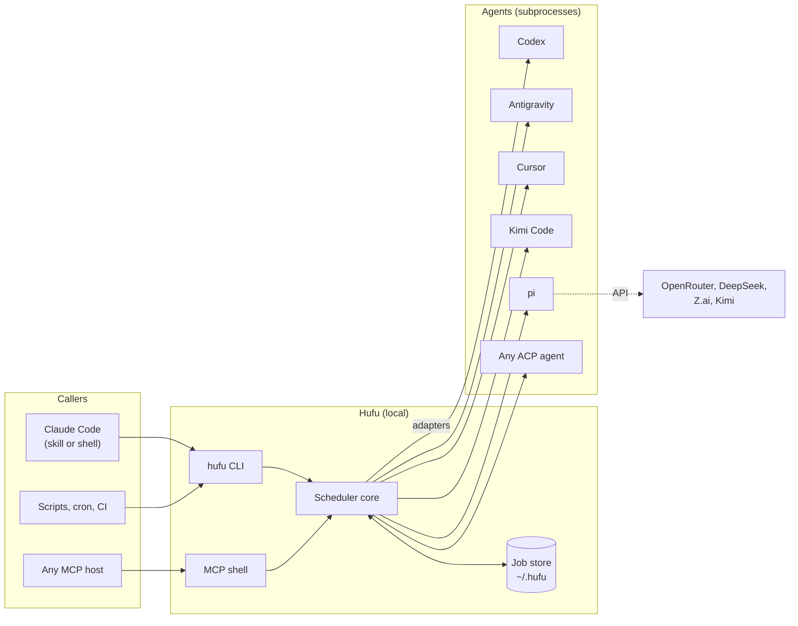
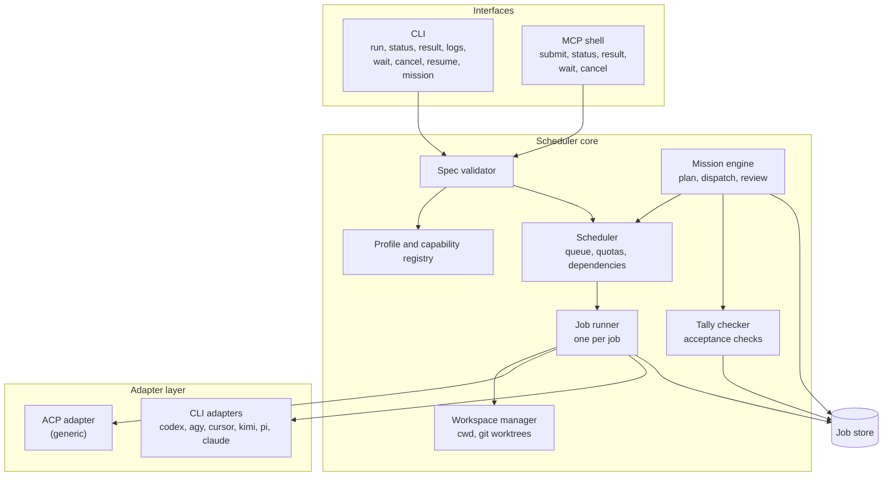
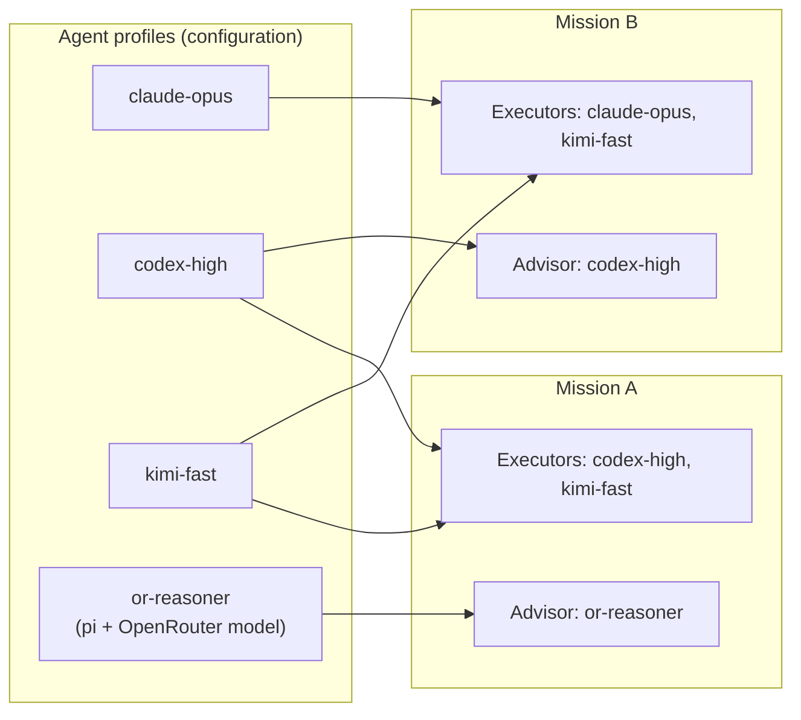
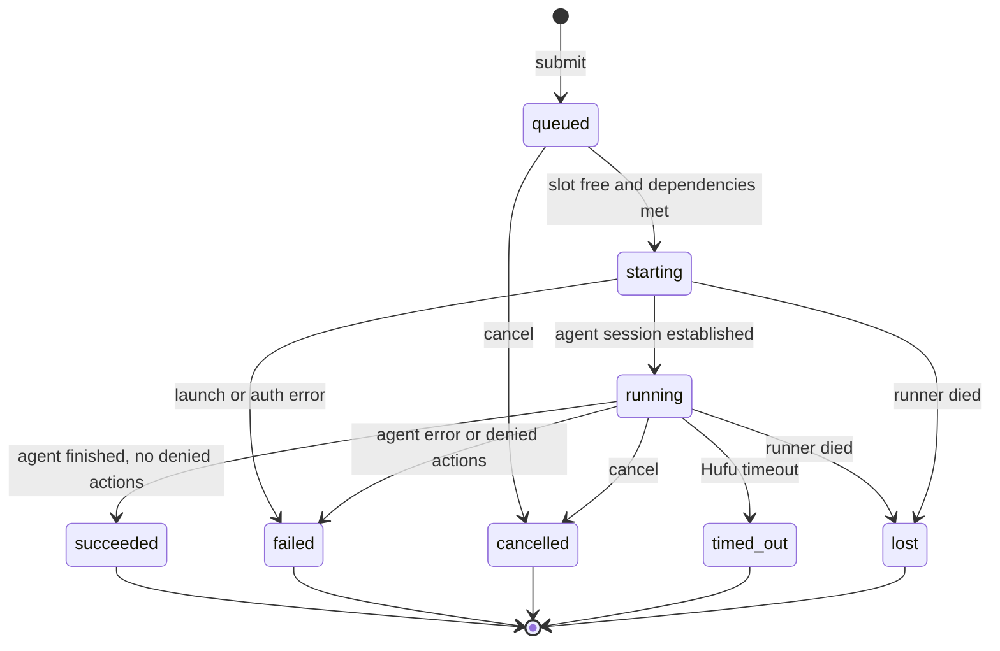
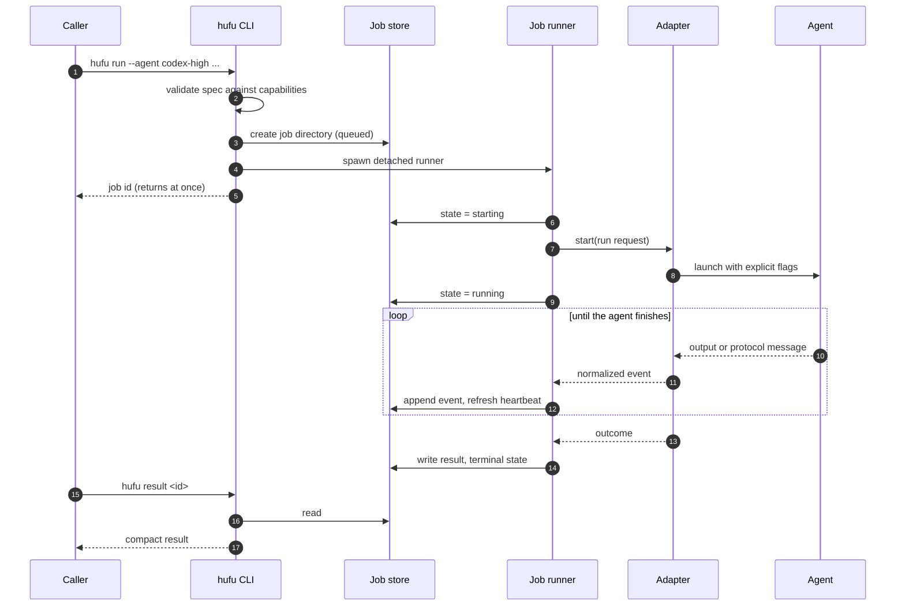
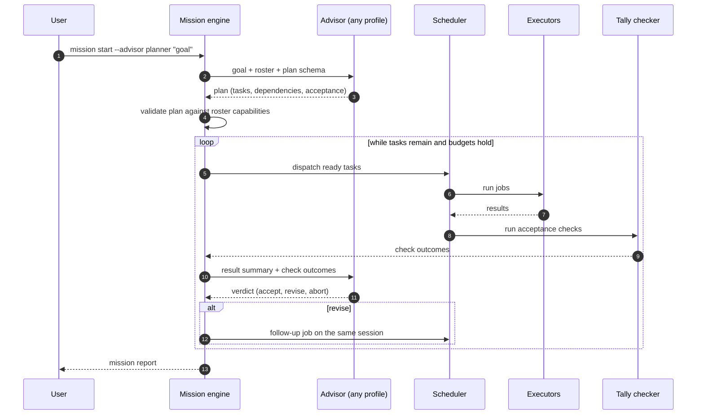

# Architecture

| | |
|---|---|
| **Status** | Draft for review |
| **Last updated** | 2026-11-12 |
| **Related** | [Requirements](../requirements/requirements.md), [Technical design](../technical/technical-design.md), [ADRs](../adr/README.md) |

This document describes the shape of the system: its parts, how they talk to each other, what
lives where, and how the design is meant to grow. Schemas, flags and file formats are in the
[technical design](../technical/technical-design.md).

## 1. Principles

1. **A standalone scheduler; every host is just a client.** Hufu is its own local program. Claude
   Code, a shell script and an MCP host all use the same core
   ([ADR-0001](../adr/0001-standalone-local-scheduler.md)).
2. **The adapter is the only part that changes with the agent.** Everything above the adapter layer
   is agent-agnostic.
3. **Roles are configuration.** Advisor and executor are both "an agent behind an adapter". What
   differs is the role a mission assigns ([ADR-0004](../adr/0004-roles-are-configuration.md)).
4. **Explicit over default.** Permissions, effort, model and timeout are stated on every run
   ([ADR-0005](../adr/0005-explicit-permission-and-effort-mapping.md)).
5. **Disk is the source of truth.** A job is a directory. Any process can read it at any time
   ([ADR-0006](../adr/0006-file-based-job-store.md)).
6. **Process success is not task success.** A separate acceptance step, the tally check, decides
   whether work is accepted.

## 2. System context

Hufu sits between callers and agents. It holds no model credentials and makes no model calls of its
own. Agents authenticate themselves, with the logins the user already set up.

## 3. Components

| Component | Responsibility | Does not do |
|---|---|---|
| **CLI** | Parse commands, print human or JSON output, set exit codes | Hold any business logic |
| **MCP shell** | Expose the same operations as MCP tools; submit returns immediately | Wait on long jobs inside a tool call |
| **Spec validator** | Normalize a task spec, apply profile defaults, check it against the profile's capabilities | Run anything |
| **Profile and capability registry** | Load configuration, resolve profiles to adapters, cache what each adapter declares it can do | Decide scheduling |
| **Scheduler** | Queue jobs, apply concurrency limits, release jobs whose dependencies are met | Talk to agents |
| **Job runner** | Own one job from start to terminal state: launch the adapter, write events, enforce the timeout, handle cancel | Know anything about a specific agent |
| **Workspace manager** | Resolve the working directory; create and clean up git worktrees | Merge branches |
| **Adapter layer** | Translate a normalized run request into an agent invocation and translate the agent's output back into normalized events | Decide policy |
| **Tally checker** | Run a task's acceptance checks and record the outcome | Fix failures |
| **Mission engine** | Run the advisor, validate its plan, dispatch tasks, feed results back, apply budgets | Plan on its own |
| **Job store** | Durable record of specs, states, events, results and missions | Run queries beyond lookup and listing |

## 4. Roles: the pluggable commander

The central abstraction is that **advisor and executor are the same kind of thing**. Both are agent
profiles resolved through the adapter layer. A mission names which profile advises and which
profiles may execute.

There are two ways to fill the advisor role, and both use the same core.

| | External advisor | Managed advisor |
|---|---|---|
| Who runs the advisor | The user's own session, for example Claude Code | Hufu, through an adapter |
| How it dispatches | Calls `hufu run`, `hufu wait`, `hufu result` | Returns a plan as JSON; Hufu dispatches |
| Who holds the loop | The host agent | The mission engine |
| Available from | M1 | M3 |
| Best for | Interactive work where a person is steering | Unattended missions and non-Claude advisors |

An advisor normally runs at the `read-only` tier. It plans and judges; it does not edit.

## 5. Life of a job

### 5.1 States

A job's **state** says what happened to the process. Its **verdict** says whether the work was
accepted: `unchecked`, `accepted` or `rejected`. They are recorded separately because an agent can
finish cleanly and still have done the wrong thing.

### 5.2 Submit and run

The caller and the runner never talk to each other directly after step 4. Everything flows through
the store. That is what lets a different session pick up the result.

## 6. Life of a mission

The tiger-tally idea shows up here as a contract: the advisor issues one half (the task spec with
its acceptance criteria), the executor returns the other (the result), and work counts only when
the two match.

## 7. Process model

The process model changes between milestones; the store format does not.

| | M1 to M3: daemonless | M4: daemon |
|---|---|---|
| Who runs a job | A detached runner process spawned by `hufu run`, one per job | The daemon, which owns all runners |
| Concurrency limits | Advisory: a lock directory counts live runners | Enforced by the daemon's queue |
| Survives the caller exiting | Yes, the runner is detached into its own session | Yes |
| Survives a reboot | No. Jobs in flight become `lost` | Queued jobs resume; running jobs become `lost` and may retry |
| MCP shell | Not offered | Thin client of the daemon |
| Setup | None | launchd or systemd unit |

Starting without a daemon keeps the first milestones small and makes every job independently
debuggable: a job is one process tree and one directory. The daemon is added when queues and quotas
need a single owner.

**Liveness.** A runner writes a heartbeat timestamp into its job state every few seconds. Any
reader that finds a non-terminal job with a stale heartbeat and no live process with the recorded
pid marks it `lost`. No job can stay `running` forever.

## 8. Security model

Hufu launches programs that can edit files and run commands. The design limits damage in layers.

| Layer | Control |
|---|---|
| **Tier** | Every job has an explicit permission tier. The default is `read-only`. `full-access` must be written out |
| **Translation** | The adapter turns the tier into the agent's own strictest matching flags. If it cannot, the job is refused |
| **Detection** | Actions the agent skipped for lack of permission are collected and by default fail the job, so a half-done task is not reported as done |
| **Isolation** | Write-capable jobs can run in a throwaway git worktree, so changes land on a branch and never in the user's working tree |
| **Credentials** | Hufu does not read or store agent logins. Each profile lists the environment variables it may pass through; nothing else from the caller's environment reaches the agent beyond a minimal base set |
| **Records** | Environment values are never written to job records |
| **Official binaries only** | Hufu drives vendor CLIs as shipped. It does not reuse their OAuth tokens or call their private APIs |

Limits that the design cannot remove:

- A permission tier is only as strong as the agent's own enforcement. Agents with no permission
  system (pi) or with approve-everything headless modes (Kimi print mode) support `full-access`
  only, and Hufu says so rather than pretending otherwise.
- Over ACP, Hufu can only answer the permission questions an agent chooses to ask.
- `full-access` jobs should be run in a container, VM or worktree. Hufu recommends this and can
  enforce the worktree; it does not provide a sandbox of its own.

## 9. Failure handling

| Failure | Detection | Result |
|---|---|---|
| Agent not installed or not logged in | Launch error, or the adapter's auth probe | `failed`, reason `agent_unavailable` or `auth_required`, with the command the user should run |
| Agent exits 0 with no output | Adapter checks for a final message | `failed`, reason `empty_output` |
| Agent soft-denied actions | Adapter parses denial notices or permission events | `failed`, reason `permission_denied`, with the list of denied actions |
| Agent hangs | Hufu timeout, plus an inactivity timeout | `timed_out`; the process tree is terminated |
| Runner crashes | Stale heartbeat and dead pid | `lost` |
| Unsupported tier, effort or model | Spec validation before launch | Submission rejected; no job is created |
| Advisor returns an invalid plan | Schema validation | One repair attempt with the error fed back, then the mission fails |
| Mission budget exhausted | Mission engine | Mission stops; finished work is kept and reported |

## 10. Technology

| Concern | Choice | Reason |
|---|---|---|
| Language and runtime | TypeScript on Node.js 22 or later | Reference ACP SDK and the most mature MCP SDK are TypeScript; most target agents already require Node; the npm name is free ([ADR-0003](../adr/0003-typescript-on-node.md)) |
| Agent protocol | `@agentclientprotocol/sdk` | Official SDK, Apache-2.0 |
| Host protocol | `@modelcontextprotocol/sdk` | Official SDK, MIT |
| Storage | Plain files: JSON, NDJSON | Readable by any tool, nothing to install, atomic by rename |
| Configuration | YAML with a published JSON Schema | Comments, editor completion, validation |
| Distribution | npm package with a `hufu` binary | Same channel users already use for their agents |

## 11. How the design grows

| Milestone | Adds | Architectural change |
|---|---|---|
| **M1** | Core, store, CLI, `agy` and Codex adapters, Claude Code skill | Daemonless baseline |
| **M2** | Generic ACP adapter, pi adapter, worktree isolation, structured output | Second adapter family; no core change |
| **M3** | Mission engine, tally checker, budgets, usage accounting | New component above the scheduler |
| **M4** | Daemon, enforced quotas, MCP shell, retries, plug-in adapters | Runner ownership moves into the daemon; store unchanged |

Each step leaves the earlier interfaces intact: a script written against the M1 CLI keeps working
after M4.
