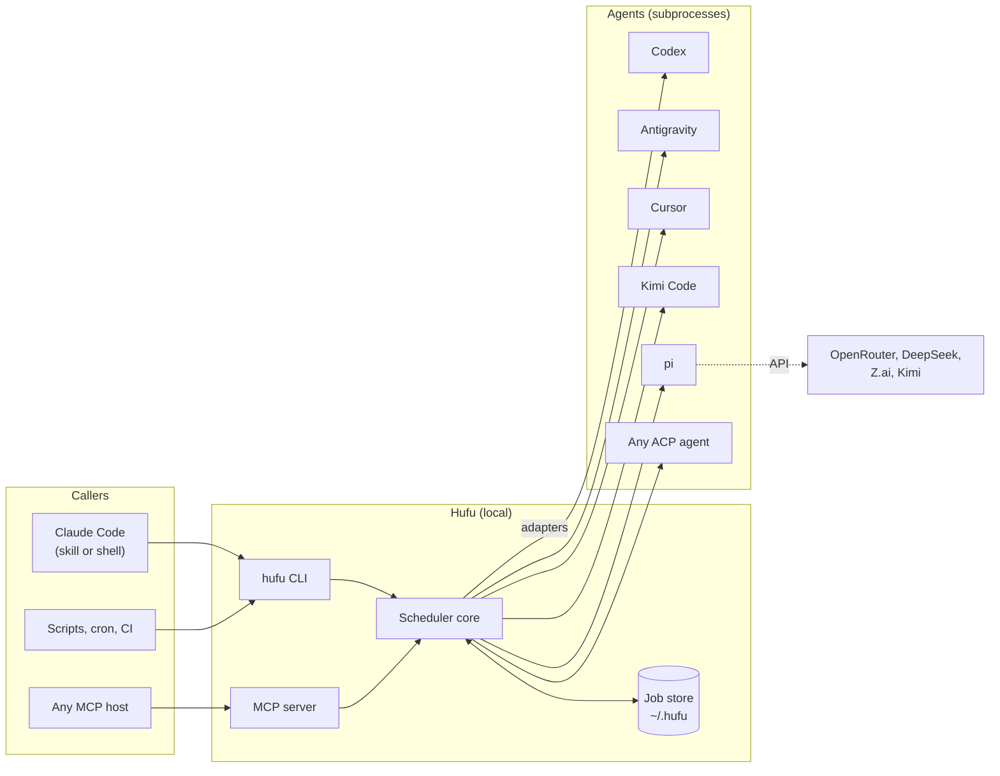
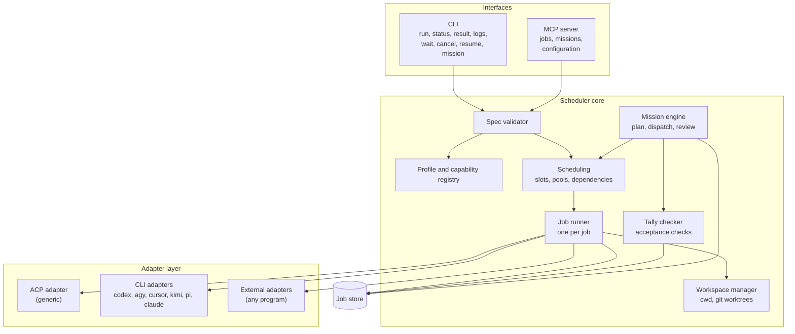
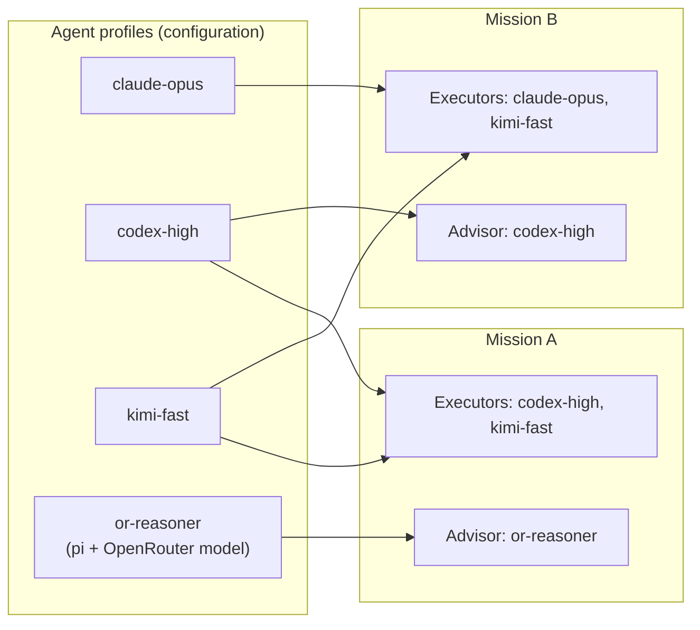
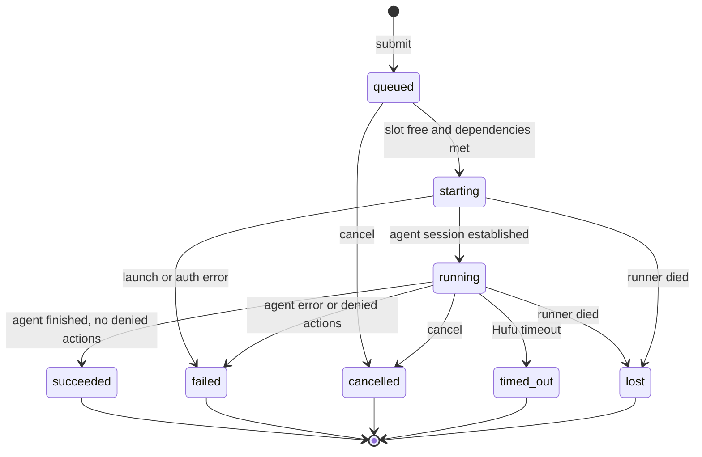
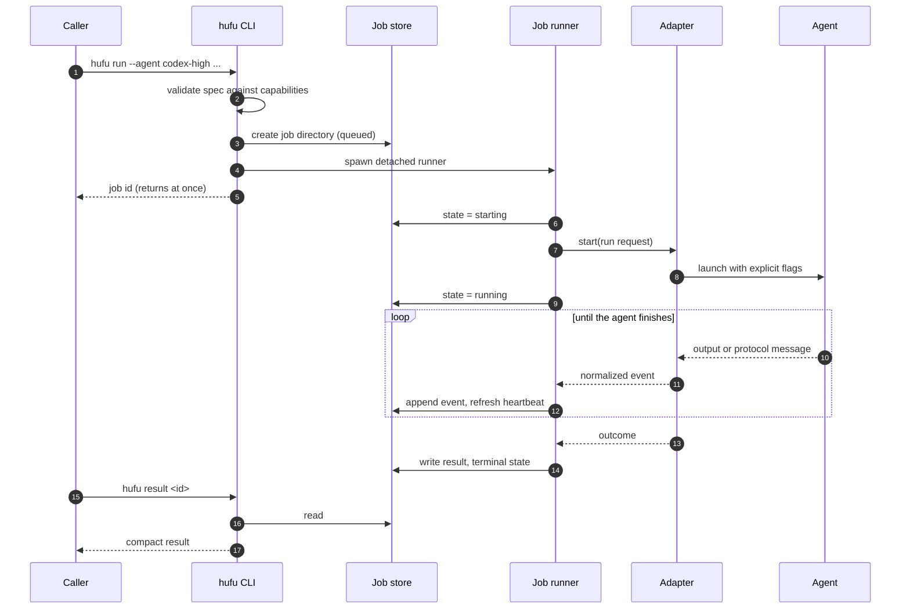
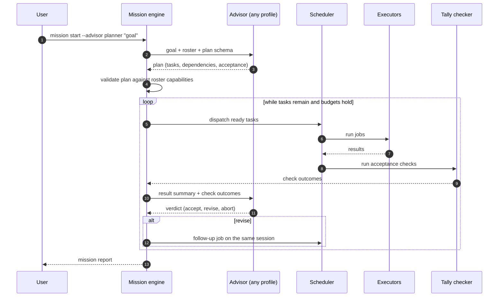
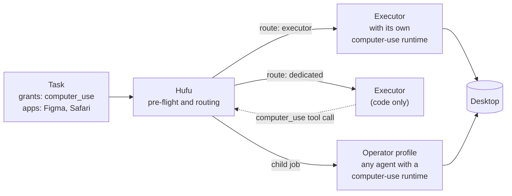

# Architecture

| | |
|---|---|
| **Status** | Describes Hufu 0.1 as implemented |
| **Last updated** | 2026-11-12 (as built: optional daemon, MCP server in the core, accounts and pools, setup, three platforms) |
| **Related** | [Requirements](../requirements/requirements.md), [Technical design](../technical/technical-design.md), [ADRs](../adr/README.md) |

This document describes the shape of the system: its parts, how they talk to each other, what
lives where, and how the design is meant to grow. Schemas, flags and file formats are in the
[technical design](../technical/technical-design.md).

## 1. Principles

1. **A standalone scheduler; every host is just a client.** Hufu is its own local program. Claude
   Code, a shell script and an MCP host all use the same core
   ([ADR-0001](../adr/0001-standalone-local-scheduler.md)).
2. **The adapter is the only part that changes with the agent.** Everything above the adapter layer
   is agent-agnostic.
3. **Roles are configuration.** Advisor and executor are both "an agent behind an adapter". What
   differs is the role a mission assigns ([ADR-0004](../adr/0004-roles-are-configuration.md)).
4. **Explicit over default.** Permissions, effort, model and timeout are stated on every run
   ([ADR-0005](../adr/0005-explicit-permission-and-effort-mapping.md)).
5. **Disk is the source of truth.** A job is a directory. Any process can read it at any time
   ([ADR-0006](../adr/0006-file-based-job-store.md)).
6. **Process success is not task success.** A separate acceptance step, the tally check, decides
   whether work is accepted.

## 2. System context

Hufu sits between callers and agents. It holds no model credentials and makes no model calls of its
own. Agents authenticate themselves, with the logins the user already set up.

## 3. Components

| Component | Responsibility | Does not do |
|---|---|---|
| **CLI** | Parse commands, print human or JSON output, set exit codes | Hold any business logic |
| **MCP server** | Expose the same operations as MCP tools, including missions and configuration; submit returns immediately | Wait on long jobs inside a tool call |
| **Spec validator** | Normalize a task spec, apply profile defaults, check it against the profile's capabilities | Run anything |
| **Profile and capability registry** | Load configuration, resolve profiles to adapters, cache what each adapter declares it can do | Decide scheduling |
| **Scheduling** | Apply concurrency limits through slot files, order pool members, release jobs whose dependencies are met. Lives in each runner; the optional daemon adds strict ordering | Talk to agents |
| **Job runner** | Own one job from start to terminal state: launch the adapter, write events, enforce the timeout, handle cancel | Know anything about a specific agent |
| **Workspace manager** | Resolve the working directory; create and clean up git worktrees | Merge branches |
| **Adapter layer** | Translate a normalized run request into an agent invocation and translate the agent's output back into normalized events | Decide policy |
| **Tally checker** | Run a task's acceptance checks and record the outcome | Fix failures |
| **Mission engine** | Run the advisor, validate its plan, dispatch tasks, feed results back, apply budgets | Plan on its own |
| **Capability router** | Decide who serves computer use for a task, check the grant and the runtime's allow-list | Operate the desktop |
| **Setup and doctor** | Write a first configuration, register with host agents, check installation and logins | Install or log in to agents |
| **Daemon** (optional) | Start queued jobs in order, restart lost jobs that may be retried, prune | Hold state of its own |
| **Job store** | Durable record of specs, states, events, results and missions | Run queries beyond lookup and listing |

## 4. Roles: the pluggable commander

The central abstraction is that **advisor and executor are the same kind of thing**. Both are agent
profiles resolved through the adapter layer. A mission names which profile advises and which
profiles may execute.

There are two ways to fill the advisor role, and both use the same core.

| | External advisor | Managed advisor |
|---|---|---|
| Who runs the advisor | The user's own session, for example Claude Code | Hufu, through an adapter |
| How it dispatches | Calls `hufu run`, `hufu wait`, `hufu result` | Returns a plan as JSON; Hufu dispatches |
| Who holds the loop | The host agent | The mission engine |
| Best for | Interactive work where a person is steering | Unattended missions and non-Claude advisors |

An advisor normally runs at the `read-only` tier. It plans and judges; it does not edit.

**One advisor, many executors.** The default advisor is a single profile. Executors are a list,
and each entry is a profile or a **pool**: a set of profiles that can stand in for each other,
typically several accounts of one agent. A pool is resolved to a member when a job starts, and the
job moves to the next member only if the first is not installed, not logged in or rate limited.
The same agent can therefore appear several times, as different models, efforts or accounts,
without the core knowing that they are "the same".

## 5. Life of a job

### 5.1 States

A job's **state** says what happened to the process. Its **verdict** says whether the work was
accepted: `unchecked`, `accepted` or `rejected`. They are recorded separately because an agent can
finish cleanly and still have done the wrong thing.

### 5.2 Submit and run

The caller and the runner never talk to each other directly after step 4. Everything flows through
the store. That is what lets a different session pick up the result.

## 6. Life of a mission

The tiger-tally idea shows up here as a contract: the advisor issues one half (the task spec with
its acceptance criteria), the executor returns the other (the result), and work counts only when
the two match.

## 7. Process model

There is no process that must be running for Hufu to work.

| Process | Started by | Lives for |
|---|---|---|
| `hufu <command>` | The caller | The command. `hufu run` returns as soon as the job is recorded |
| Runner, `hufu __runner <job>` | `hufu run`, the daemon, or a mission driver | One job. Detached from whoever started it |
| Agent | The runner, through an adapter | One attempt, in its own process group |
| Mission driver, `hufu __mission <id>` | `hufu mission start` or `resume` | One mission, or until paused. Detached |
| MCP server, `hufu mcp` | A host agent | The host's session. Calls the same functions as the CLI |
| Daemon, `hufu daemon run` | The user, optionally | Until stopped |

| | Without the daemon | With the daemon |
|---|---|---|
| Who starts a runner | `hufu run`, at once | The daemon, oldest queued job first |
| Concurrency limits | Hold: each runner takes a slot file before it starts its agent | Hold, and waiting jobs start in submission order |
| Survives the caller exiting | Yes | Yes |
| A runner dies | The job becomes `lost` when next read | The same, and the daemon restarts it if its retry policy allows |
| The daemon dies | | Jobs left in its queue start themselves the next time their status is read |

Keeping the daemon optional makes every job independently debuggable: a job is one process tree
and one directory. All of these processes are the same executable, so there is nothing to keep in
step.

**Liveness.** A runner writes a heartbeat timestamp into its job state every few seconds. Any
reader that finds a non-terminal job with a stale heartbeat and no live runner process marks it
`lost`. No job can stay `running` forever. The daemon and mission drivers use the same pattern.

**Platforms.** Linux, macOS and Windows are equal targets. Everything that differs between them
(detaching a process, process groups, ending a process tree, finding programs, the base
environment) is in one module, `hufu-contract/src/proc.rs`. Coordination between processes uses
only files, so it behaves the same everywhere: marker files for cancel, pause and stop requests
rather than signals, and renames for atomic writes.

## 8. Security model

Hufu launches programs that can edit files and run commands. The design limits damage in layers.

| Layer | Control |
|---|---|
| **Tier** | Every job has an explicit permission tier. The default is `read-only`. `full-access` must be written out |
| **Translation** | The adapter turns the tier into the agent's own strictest matching flags. If it cannot, the job is refused |
| **Detection** | Actions the agent skipped for lack of permission are collected and shown in the result, and fail the job when the task asks for strict permissions |
| **Verification** | After a `read-only` job, Hufu compares the workspace with its state before the job. Changed files fail the job, whatever the agent's own controls did |
| **Isolation** | Write-capable jobs can run in a throwaway git worktree, so changes land on a branch and never in the user's working tree |
| **Credentials** | Hufu does not read or store agent logins. Each profile lists the environment variables it may pass through; nothing else from the caller's environment reaches the agent beyond a minimal base set. Several accounts are told apart by login directory or variable name, never by a stored secret |
| **Configuration** | Every change, by command or over MCP, is validated against the whole configuration before it is written. Values that look like secrets are refused |
| **Records** | Environment values are never written to job records |
| **Official binaries only** | Hufu drives vendor CLIs as shipped. It does not reuse their OAuth tokens or call their private APIs |

Limits that the design cannot remove:

- A permission tier is only as strong as the agent's own enforcement. Kimi's print mode approves
  everything and supports `full-access` only; pi has no permission system and supports `read-only`
  (by offering it only its read tool) and `full-access`. Hufu says so rather than pretending
  otherwise.
- An agent connected over MCP can change Hufu's configuration, including adding profiles. That is
  the point of the configuration tools, and it means a host agent should be trusted about as much
  as a shell. It cannot make `full-access` the default tier, and it cannot store a secret.
- Over ACP, Hufu can only answer the permission questions an agent chooses to ask.
- `full-access` jobs should be run in a container, VM or worktree. Hufu recommends this and can
  enforce the worktree; it does not provide a sandbox of its own.

## 9. Failure handling

| Failure | Detection | Result |
|---|---|---|
| Agent not installed or not logged in | Launch error, or the adapter's auth probe | `failed`, reason `agent_unavailable` or `auth_required`, with the command the user should run |
| Agent exits 0 with no output | Adapter checks for a final message | `failed`, reason `empty_output` |
| Agent soft-denied actions | Adapter parses denial notices or permission events | Listed in the result as denied actions; with `strict_permissions`, `failed` with reason `permission_denied` |
| A read-only job changed files | Workspace comparison after the job | `failed`, reason `tier_violated` |
| One account is rate limited or logged out | The adapter's reason code | The next member of the pool runs the job; without a pool, `failed` with that reason |
| Agent hangs | Hufu timeout, plus an inactivity timeout | `timed_out`; the process tree is terminated |
| Runner crashes | Stale heartbeat and dead pid | `lost`; restarted by the daemon when the retry policy allows |
| A bug inside the runner or an MCP tool | Caught at the boundary | The job ends `failed` with `internal_error`; the MCP server answers with an error and keeps running |
| Unsupported tier, effort or model | Spec validation before launch | Submission rejected; no job is created |
| Advisor returns an invalid plan | Schema validation | One repair attempt with the error fed back, then the mission fails |
| Mission budget exhausted | Mission engine | Mission stops; finished work is kept and reported |

## 10. Technology

| Concern | Choice | Reason |
|---|---|---|
| Language | Rust, stable toolchain | One static binary, fast start-up, direct control of processes, crate boundaries that enforce the layering ([ADR-0007](../adr/0007-implement-in-rust.md)) |
| Concurrency | Threads and blocking I/O, no async runtime | A job is one agent process and two pipes; the simple model is enough and easier to get right on three platforms ([ADR-0009](../adr/0009-synchronous-core-and-own-protocol-clients.md)) |
| Agent protocol | An ACP v1 client written for Hufu | Small, tolerant of agents that differ, no dependency that pulls in a runtime (same record) |
| Host protocol | An MCP server written for Hufu | Same reasons |
| Storage | Plain files: JSON, NDJSON | Readable by any tool, nothing to install, atomic by rename ([ADR-0006](../adr/0006-file-based-job-store.md)) |
| Configuration | YAML, validated as a whole | Comments, and every problem reported at once |
| Distribution | Prebuilt `hufu` binary per platform; package `hufu-cli` | No runtime to install; independent of the Node.js versions agents require |

## 11. How the design grew

The plan had five milestones after the foundation. They were implemented together, and the
architecture ended up simpler than planned in two places.

| Milestone | Added | What it meant for the architecture |
|---|---|---|
| **M1** | Core, store, CLI, `agy` and Codex adapters, Claude Code skill | The daemonless baseline, which stayed the baseline |
| **M2** | Generic ACP adapter, pi, Cursor, Kimi, Claude Code and external adapters, worktrees, structured output | More adapters; no core change |
| **M3** | Mission engine, tally checker, budgets, usage accounting | A component above scheduling, driven by its own detached process |
| **M4** | Daemon, limits, pools, MCP server, retries, setup | **Changed from the plan:** runners did not move into the daemon. Limits are enforced by slot files that every runner honours, so the daemon became an optional helper and the MCP server does not need it |
| **M5** | Capability routing, starting with computer use | Jobs gained parent links and grants; a display slot joined the limits ([section 12](#12-capability-routing)) |

The interfaces of each step are intact in the next: a script written against the job commands does
not need to know that missions, pools or a daemon exist.

## 12. Capability routing

Roles answer "who plans and who executes". Capabilities answer a different question: **when a task
needs something beyond code tools, which agent provides it?** The first capability is computer use,
meaning an agent operating a desktop or browser through its interface. It can be served by any
configured executor that supports computer use, or by a profile configured only for it
([ADR-0008](../adr/0008-computer-use-is-a-routable-capability.md), reference study:
[LCU](../research/computer-use.md)).

| Element | Role |
|---|---|
| **Capability declaration** | A profile states that it provides computer use, built in or through an attached runtime such as LCU. Hufu does not bundle or install a runtime. A profile that does not declare it is refused wherever computer use would land on it |
| **Route** | `executor` (the job's own agent) or `dedicated` (the profile named in configuration, which may be one of the executors or a profile of its own), overridable per task |
| **Grant and app scope** | The task must grant the capability and name the applications. No permission tier implies it |
| **Pre-flight** | Hufu checks that the runtime is present and the applications are already allowed, and rejects the task otherwise. It never answers a runtime's approval prompt |
| **Child job** | In the dedicated route, each hand-over is a job of its own, linked to its parent, with its own record and result. The executor reaches it through a one-tool MCP server that Hufu attaches to its session |
| **Display slot** | One computer-use job per display at a time |

Two properties shape everything else. Computer use cannot be contained by a worktree or a
permission tier, so a grant is treated as wider than `full-access`. And approval of an application
belongs to a person, so anything not allowed in advance fails closed.

