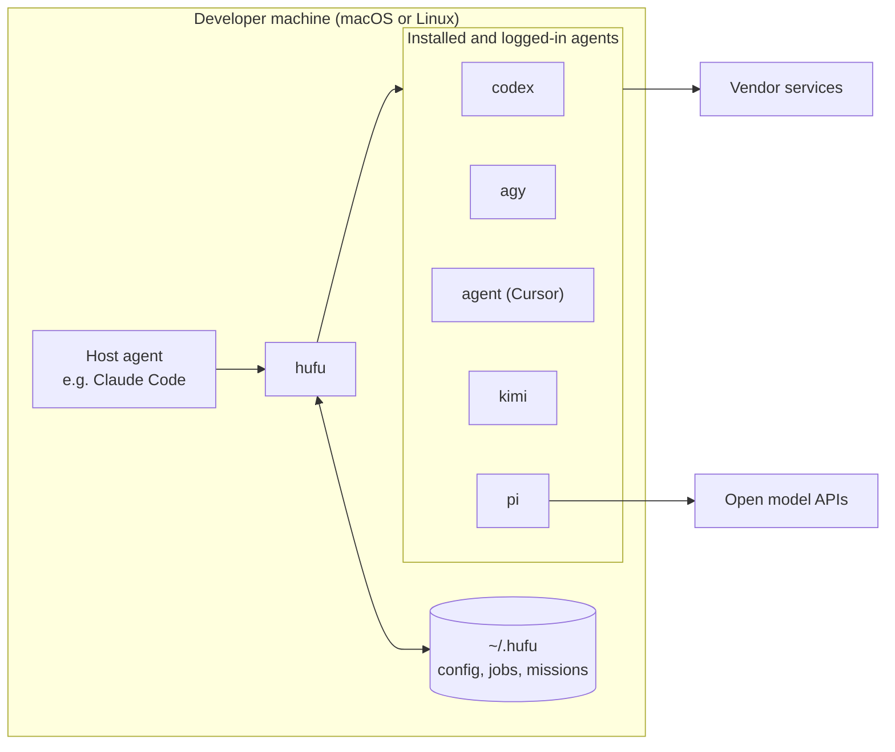

# Deployment and Operations

| | |
|---|---|
| **Status** | Plan. Hufu has no release yet, so the commands below describe the intended experience |
| **Last updated** | 2026-11-12 |
| **Related** | [Architecture](../architecture/architecture.md), [Cloud environment](cloud-environment.md), [Roadmap](../roadmap.md) |

Hufu is deployed on a developer's own machine, next to the agents it drives. There is no server to
host. "Deployment" means: install the CLI, point it at the agents already installed, connect a
host agent, and, from M4, optionally run a daemon.

## 1. Where Hufu runs



| Environment | Suitable? | Why |
|---|---|---|
| Developer laptop or desktop | **Yes, primary target** | The agents and their logins are here |
| A dedicated always-on machine (for example a Mac mini) | Yes | Good for long unattended missions; reachable from a laptop over SSH or a remote-control session |
| CI runners | Partly | Only agents that accept an API key work. Subscription logins do not transfer |
| Cloud development containers | For developing Hufu itself, yes. For driving real agents, mostly no | See [Cloud environment](cloud-environment.md) |

## 2. Prerequisites

| Requirement | Version | Notes |
|---|---|---|
| Node.js | ≥ 22.19 | Floor set by pi |
| Git | Any recent | Required for worktree isolation and change detection |
| At least one agent CLI | See below | Installed and logged in by the user |
| Operating system | macOS or Linux | Windows is not a target before M4 |

Agents are installed and authenticated the way their vendors document. Hufu does not install them
and does not log in for the user.

| Agent | Install (per vendor) | Log in once |
|---|---|---|
| Codex | `npm install -g @openai/codex` | `codex login` |
| Antigravity | Vendor installer | Run `agy` interactively once |
| Cursor | `curl https://cursor.com/install -fsS \| bash` | `agent login`, or set `CURSOR_API_KEY` |
| Kimi Code | Vendor installer | `kimi login` |
| pi | `npm install -g --ignore-scripts @earendil-works/pi-coding-agent` | Provider API key in the environment |

## 3. Install

Planned for the first release (M1):

```bash
npm install -g hufu        # the npm name is free as of 2026-11-12 and still to be reserved
hufu doctor                # finds installed agents, prints versions and login state
```

From source, once code exists:

```bash
git clone https://github.com/kverona-ai/hufu.git
cd hufu/src
pnpm install && pnpm build
pnpm link --global
```

## 4. Configure

1. `hufu doctor` lists the agents it found and writes a starter `~/.hufu/config.yaml` on request,
   with one profile per agent at the `read-only` default.
2. Edit profiles: choose models and effort, and raise the default tier only where intended. A
   commented sample is in [`doc/examples/config.yaml`](../examples/config.yaml).
3. For agents that use API keys, export the key in the shell profile and list the variable's
   **name** in the profile's `env`. Hufu passes it through and never stores it.
4. Optionally add `<project>/.hufu/config.yaml` for project-specific profiles or limits.

| Variable | Purpose |
|---|---|
| `HUFU_HOME` | Location of configuration and job data. Default `~/.hufu` |
| `HUFU_CONFIG` | Path to an alternative global configuration file |
| `HUFU_LOG_LEVEL` | `error`, `warn`, `info`, `debug` |
| `HUFU_LIVE` | Enables live smoke tests against real agents during development |

## 5. Connect a host agent

### Claude Code (M1)

Two options ship with the package under `src/integrations/claude-code/`:

- **Skill.** Installs a skill that teaches Claude when to delegate and how to use `hufu run`,
  `hufu wait` and `hufu result`.
- **Snippet.** A short section for `CLAUDE.md` with the same rules, for teams that prefer plain
  project instructions.

Both tell the host to submit in the background, keep working, and fetch compact results, so the
host's context stays small.

### Any MCP host (M4)

```bash
claude mcp add hufu -- hufu mcp
```

or the equivalent entry in another host's MCP configuration. The MCP shell needs the daemon.

### Scripts and CI

```bash
hufu run --agent codex-high --permission workspace-write --timeout 30m --wait --json \
  -f task.yaml > result.json
echo "exit: $?"            # 0 accepted, 3 failed, 5 timed out, 8 rejected by tally check
```

## 6. Run modes

| Mode | From | How | Use when |
|---|---|---|---|
| **On demand** | M1 | Nothing to start. Each `hufu run` spawns its own detached runner | Normal interactive use |
| **Daemon** | M4 | `hufu daemon start`, or a service unit | Queues, enforced quotas, the MCP shell, jobs that should start after a reboot |

Service units planned for M4:

- **macOS:** a launchd agent at `~/Library/LaunchAgents/llc.kverona.hufu.plist`, running as the
  user, so that agents find their logins in the user's home.
- **Linux:** a systemd user unit, `systemctl --user enable --now hufu`.

The daemon always runs as the logged-in user, never as root, because the agents' credentials belong
to that user.

## 7. Security hardening

| Recommendation | Reason |
|---|---|
| Keep the global default tier at `read-only` | A forgotten flag then costs nothing |
| Use `isolation: worktree` for every write-capable job | Changes land on a branch for review, never in the working tree |
| Run `full-access` profiles (pi, Kimi print mode) inside a container or VM | These agents have no permission system; Hufu cannot add one |
| List only the environment variables a profile needs | Limits what a misbehaving agent can read |
| Do not commit `~/.hufu`; do commit `<project>/.hufu/config.yaml` | Job records can contain code and prompts; project configuration holds no secrets |
| Review vendor terms before unattended use of subscription plans | See the [agent landscape](../research/agent-landscape.md#34-antigravity-cli-agy) |

## 8. Operations

| Task | Command |
|---|---|
| Check agents and versions | `hufu doctor` |
| See what is running | `hufu status --all` |
| Follow a job | `hufu logs <job> --follow` |
| Stop a job | `hufu cancel <job>` |
| Clean up old jobs | `hufu prune --older-than 30d` |
| Remove finished worktrees | `hufu prune --worktrees` |
| Back up | Copy `~/.hufu/config.yaml`. Job data is disposable |
| Upgrade | `npm install -g hufu@latest`, then `hufu doctor` |
| Uninstall | `npm uninstall -g hufu`, then delete `~/.hufu` |

**Disk use.** A job directory holds the raw agent output, which can reach tens of megabytes for
long runs. Prune on a schedule.

## 9. Troubleshooting

| Symptom | Likely cause | Fix |
|---|---|---|
| `failed: auth_required` | The agent has no saved login | Run the agent's own login command once, interactively |
| `failed: empty_output` on `agy` | The non-TTY stdout bug in some `agy` versions | Upgrade `agy`; enable the PTY fallback in the profile if the adapter offers it |
| `failed: permission_denied` | The agent skipped actions the tier does not allow | Raise the tier explicitly, or add allow rules in the agent's own settings |
| Submission rejected: tier not supported | The agent cannot honour that tier headlessly | Use a supported tier with worktree isolation, or the agent's ACP profile |
| Job shows `lost` | The runner was killed, or the machine slept or restarted | Resubmit. From M4 the daemon can retry |
| `codex` refuses to run outside a repository | Codex requires a Git repository by default | Run inside a repository, or let the adapter pass the skip flag |

## 10. Release and distribution (for maintainers)

Planned from M1:

- Versions are tagged in Git; the npm package is published from `src/` by CI on tag.
- CI on every pull request: type check, lint, unit tests, fake-agent tests, the conformance suite
  and a Markdown link check for `doc/`.
- Live smoke tests run on a maintainer's machine before each release, because they need real
  logins. Their results are attached to the release notes.
- The npm name `hufu` should be reserved before the first public announcement.
