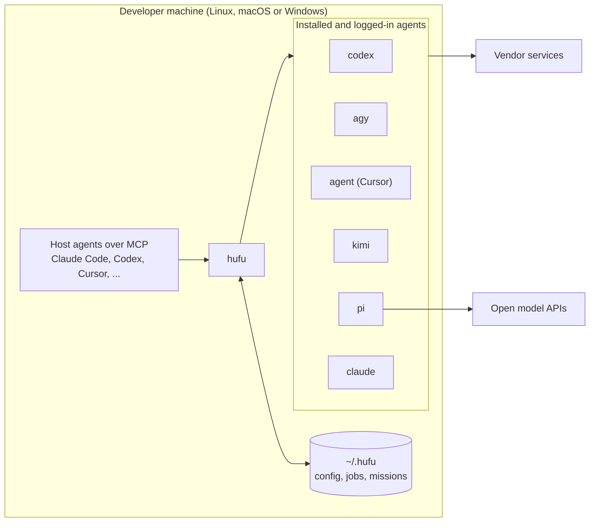

# Deployment and Operations

| | |
|---|---|
| **Status** | Describes Hufu 0.1 as implemented. No release has been tagged yet, so the install scripts build from source until the first tag |
| **Last updated** | 2026-11-13 (`hufu update`, release workflow with a manifest and checks) |
| **Related** | [Agent install guide](../guide/agent-install.md), [User guide](../guide/user-guide.md), [Architecture](../architecture/architecture.md), [Cloud environment](cloud-environment.md), [Roadmap](../roadmap.md) |

Hufu is deployed on a developer's own machine, next to the agents it drives. There is no server to
host. "Deployment" means: install the one binary, point it at the agents already installed, connect
the agents that should be able to dispatch, and optionally run a daemon. `hufu up` does all of that
in one command.

## 1. Where Hufu runs



| Environment | Suitable? | Why |
|---|---|---|
| Developer laptop or desktop | **Yes, primary target** | The agents and their logins are here |
| A dedicated always-on machine (for example a Mac mini) | Yes | Good for long unattended missions; reachable from a laptop over SSH or a remote-control session |
| CI runners | Partly | Only agents that accept an API key work. Subscription logins do not transfer |
| Cloud development containers | For developing Hufu itself, yes. For driving real agents, mostly no | See [Cloud environment](cloud-environment.md) |

## 2. Prerequisites

| Requirement | Version | Notes |
|---|---|---|
| Hufu | One self-contained binary | No language runtime is needed for Hufu itself |
| Git | Any recent | Needed for worktree isolation. Without it, change detection falls back to comparing file sizes and times |
| At least one agent CLI | See below | Installed and logged in by the user |
| Operating system | Linux, macOS or Windows; x86-64 or ARM64 | Linux binaries are static and run on any distribution |

Agents are installed and authenticated the way their vendors document. Hufu does not install them
and does not log in for the user. Some agents need Node.js; that is the agent's requirement, not
Hufu's.

| Agent | Install (per vendor) | Log in once |
|---|---|---|
| Codex | `npm install -g @openai/codex` | `codex login` |
| Antigravity | Vendor installer | Run `agy` interactively once |
| Cursor | `curl https://cursor.com/install -fsS \| bash` | `agent login`, or set `CURSOR_API_KEY` |
| Kimi Code | Vendor installer | `kimi login` |
| Claude Code | Vendor installer | Run `claude` interactively once |
| pi | `npm install -g --ignore-scripts @earendil-works/pi-coding-agent` (needs Node.js ≥ 22.19) | Provider API key in the environment |

## 3. Install

The package is `hufu-cli`; the command is `hufu`.

Most installations are done by an agent on the user's behalf. The steps it follows, with the
checks to make after each one, are in the [agent install guide](../guide/agent-install.md). The
channels are the same either way:

| Channel | Command | Notes |
|---|---|---|
| Install script, macOS and Linux | `curl -fsSL https://raw.githubusercontent.com/kverona-ai/hufu/main/src/install/install.sh \| sh` | Installs to `~/.local/bin` |
| Install script, Windows | `irm https://raw.githubusercontent.com/kverona-ai/hufu/main/src/install/install.ps1 \| iex` | Installs to `%LOCALAPPDATA%\hufu\bin` and adds it to the user `PATH` |
| Cargo | `cargo install --git https://github.com/kverona-ai/hufu hufu-cli --locked` | Builds from source; needs Rust 1.89 or newer |
| From a checkout | `cd src && cargo build --release -p hufu-cli`, then copy `target/release/hufu` | |

What the install scripts do, and nothing more:

1. Work out the platform and download `hufu-<target>.tar.gz` (or `.zip`) and its `.sha256` from the
   latest GitHub release.
2. Verify the checksum. A mismatch, or a release without a checksum, stops the install.
3. Copy one file, `hufu`, into the install directory.
4. If no prebuilt binary can be downloaded (no release yet, or an unsupported platform), build with
   `cargo install` instead, if Rust is present.

| Option | Environment variable | Meaning |
|---|---|---|
| `--up` / `-Up` | `HUFU_UP=1` | Run `hufu up` afterwards |
| `--version <tag>` / `-Version` | `HUFU_VERSION` | A specific release instead of the latest |
| `--dir <path>` / `-Dir` | `HUFU_INSTALL_DIR` | Where to put the binary |
| `--from-source` / `-FromSource` | `HUFU_FROM_SOURCE=1` | Always build with cargo |
| | `HUFU_DOWNLOAD_BASE` | A mirror that holds the release files, for networks that cannot reach GitHub. `hufu update` reads it too |

Options are passed to a piped script like this: `curl ... | sh -s -- --up --dir /opt/bin`.

Prebuilt targets: `x86_64-unknown-linux-musl`, `aarch64-unknown-linux-musl`, `x86_64-apple-darwin`,
`aarch64-apple-darwin`, `x86_64-pc-windows-msvc`, `aarch64-pc-windows-msvc`.

Not offered yet: Homebrew, crates.io and npm. They need accounts and names that the maintainers
have to set up; see section 10.

## 4. Set up

```bash
hufu up
```

| Step | Equivalent command | Result |
|---|---|---|
| Configuration | `hufu init` | `~/.hufu/config.yaml` with one profile per agent found, a default advisor and default executors. An existing file is kept. With no agent found, no file is written |
| Host registration | `hufu setup` | Hufu's MCP server registered with every agent found. `hufu up --no-setup` skips it |
| Daemon | `hufu daemon start` | The optional daemon runs. `hufu up --no-daemon` skips it |
| Check | `hufu doctor` | A table of agents with installation and login state, and the next steps |

`hufu up` needs at least one agent to dispatch to. With none on `PATH` it stops before the first
step changes anything, lists the install and login command of every supported agent, and exits
with code `10`; run it again once an agent is installed. With exactly one agent it succeeds and
notes, under the next steps, that this agent is both the advisor and the only executor. An
installer started with `--up` passes a failed `hufu up` on: it says that the program is installed
and that setup is not finished, and ends with the same exit code.

Then adjust to taste, by command, by hand or through any connected agent:

- models, effort and accounts: `hufu profile add|set`; see the
  [user guide](../guide/user-guide.md#4-agents-accounts-and-pools)
- several accounts of one agent: one profile each, with `--home` or `--env-from`, and a pool over them
- who advises and who executes: `hufu config set roles.advisor ...`, `roles.executors`
- who operates the desktop: `capabilities.computer_use`
- project-specific settings: add `--project` to write `<project>/.hufu/config.yaml`

For agents that use API keys, export the key in the shell profile and list the variable's **name**
in the profile's `env`. Hufu passes it through and never stores it.

| Variable | Purpose |
|---|---|
| `HUFU_HOME` | Location of configuration and job data. Default `~/.hufu` |
| `HUFU_EXE` | The `hufu` program that `hufu setup` writes into other agents' settings, when it should not be the running one |
| `HUFU_KILL_GRACE_MS` | How long a cancelled agent gets to stop by itself. Default 10000 |
| `HUFU_STALE_AFTER_MS` | After how long without a heartbeat a job with a dead runner counts as lost. Default 30000 |

A complete, commented sample is [`doc/examples/config.yaml`](../examples/config.yaml).

## 5. Connect host agents

`hufu setup` registers the MCP server `hufu` (command `hufu mcp`, over stdio) with the agents found
on the machine, or with the ones named by `--agent`.

| Host | Where the registration goes | Project scope (`--project`) |
|---|---|---|
| Claude Code | `claude mcp add --scope user hufu`, plus the skill under `~/.claude/skills/hufu/` | `.mcp.json` and `.claude/skills/hufu/` in the project |
| Codex | A marked block in `~/.codex/config.toml` | |
| Cursor | `~/.cursor/mcp.json` | |
| Kimi Code | `~/.kimi-code/mcp.json` | |
| Antigravity | `~/.gemini/config/mcp_config.json` | |
| Anything else | `hufu setup --agent generic --print` prints the entry to add by hand | |

`--print` shows what would be written, `--remove` takes it out again. Files are edited in place:
other servers stay, and the original is copied once to `<file>.hufu-bak`. Each agent's own
configuration variable (`CODEX_HOME`, `CLAUDE_CONFIG_DIR`, `CURSOR_CONFIG_DIR`, `KIMI_CODE_HOME`)
is honoured.

The Claude Code skill and a snippet for `CLAUDE.md` are in `src/integrations/claude-code/`. Both
tell the host to submit in the background, keep working, and fetch compact results, so the host's
context stays small.

### Scripts and CI

```bash
hufu --json run -a codex -p workspace-write --timeout 30m --wait -f task.yaml > result.json
echo "exit: $?"            # 0 accepted, 3 failed, 5 timed out, 8 rejected by a check, 10 not logged in
```

## 6. Run modes

| Mode | How | Use when |
|---|---|---|
| **On demand** | Nothing to start. Each `hufu run` starts its own detached runner. Limits on concurrent jobs hold | Normal use |
| **Daemon** | `hufu daemon start`, or `hufu daemon run` under a service manager | Strict start order for queued jobs, automatic restart of lost jobs that may be retried, hourly pruning |

The daemon keeps no state of its own; it can be stopped and started at any time, and stopping it
does not touch running jobs. It is not needed for the MCP server.

To start it at login, run `hufu daemon run` from a service manager, always as the logged-in user
and never as root, because the agents' credentials belong to that user:

- **macOS:** a launchd agent in `~/Library/LaunchAgents/` with `ProgramArguments` `hufu daemon run`.
- **Linux:** a systemd user unit with `ExecStart=%h/.local/bin/hufu daemon run`, enabled with
  `systemctl --user enable --now hufu`.
- **Windows:** a scheduled task that runs `hufu daemon run` at logon.

Hufu does not install these units itself.

## 7. Security hardening

| Recommendation | Reason |
|---|---|
| Keep the global default tier at `read-only` | A forgotten flag then costs nothing. `full-access` cannot be made the global default at all |
| Use `isolation: worktree` for every write-capable job | Changes land on a branch for review, never in the working tree |
| Run `full-access` profiles (pi, Kimi print mode) inside a container or VM | These agents have no sandbox of their own; Hufu cannot add one |
| Mark an ACP profile `verified` only after watching it ask before acting | Until then Hufu treats it as `full-access` only, which is the honest description |
| List only the environment variables a profile needs | Agents get a small fixed environment plus those names; nothing else from your shell |
| Grant computer use per task and per application | A grant names the applications. The desktop runtime's own allow-list is never widened by Hufu |
| Do not commit `~/.hufu`; do commit `<project>/.hufu/config.yaml` | Job records contain prompts and agent output, unencrypted; project configuration holds no secrets |
| Review vendor terms before unattended use of subscription plans | See the [agent landscape](../research/agent-landscape.md#34-antigravity-cli-agy) |

## 8. Operations

| Task | Command |
|---|---|
| Check agents, logins and configuration | `hufu doctor`; `hufu agents --probe` |
| Prove the machine can run jobs at all | `hufu doctor --self-test` (no account, no network) |
| See what is running | `hufu status`; `hufu status --all` |
| Follow a job | `hufu logs <job> --follow` |
| Stop a job | `hufu cancel <job>`; `--force` to skip the grace period |
| Clean up old jobs | `hufu prune --older-than 30d`; add `--worktrees` for leftover worktrees |
| Back up | Copy `~/.hufu/config.yaml`. Job data is disposable |
| See whether a newer release exists | `hufu update --check` |
| Upgrade | `hufu update`. It downloads and checks the newest release, replaces the program, restarts the daemon if one was running and runs `hufu doctor`. Running jobs keep the binary they started with |
| Install a particular release, or go back to one | `hufu update --version v0.2.0` |
| Uninstall | `hufu setup --remove`, `hufu daemon stop`, delete the `hufu` binary, then delete `~/.hufu` |

**Updating.** `hufu update` is described in the
[user guide](../guide/user-guide.md#updating). What matters for operations:

- It needs `curl` or `wget`, and `tar`. Windows ships both since Windows 10 version 1803. Where
  they are missing, running the install script again does the same job, without the restart of
  the daemon and the checks.
- It replaces the file it runs from, so it needs write access to that directory, as the user that
  installed Hufu. It never asks for more rights.
- Agents that have Hufu connected keep their old MCP server until they are restarted. Such a
  server still starts jobs, and those jobs run with the new program.
- A mirror for `HUFU_DOWNLOAD_BASE` holds the files of one release side by side:
  `hufu-manifest.json`, the six archives and, for the install scripts, their `.sha256` files.
  `hufu update` also accepts a local directory there.
- With no release to download, it builds from source with cargo, like the install scripts.

**Disk use.** A job directory holds the raw agent output, which can reach tens of megabytes for
long runs. `retention` in the configuration bounds it (30 days and 2000 jobs by default); the
daemon prunes hourly, and `hufu prune` does it on demand.

## 9. Troubleshooting

| Symptom | Likely cause | Fix |
|---|---|---|
| Exit 10, `agent_unavailable` | The agent's program is not on `PATH` | Install it, or set the profile's `command` |
| Exit 10, `auth_required` | No saved login, or the variable named in the message is not exported | Log the agent in once, interactively; export the variable |
| `failed: empty_output` | The agent exited without an answer | `hufu logs <job> --raw --stderr` shows what it printed |
| `failed: tier_violated` | A read-only job changed files | Use `workspace-write` if writing was intended |
| Submission refused: tier not supported | The agent cannot enforce that tier headlessly | Use a supported tier with worktree isolation, or the agent's ACP profile |
| Job shows `lost` | The runner was killed, or the machine slept or restarted | `hufu resume`, or run again. With the daemon and `--retry` this is automatic |
| `hufu setup` did nothing for an agent | It was not found on `PATH` | `hufu setup --agent <name>`, or `--all` |
| `hufu update`: `cannot write next to ...` | The program belongs to another user, or to a package manager | Run it as the user that installed Hufu, or run the install script again |
| `hufu update`: `checksum mismatch` | A damaged download, or a mirror that mixes two releases | Nothing was changed. Try again; check the mirror |
| `hufu update` starts a cargo build | No release with a binary for this platform was found | Expected before the first release and on unsupported platforms; otherwise check `HUFU_DOWNLOAD_BASE` |

More in the [user guide](../guide/user-guide.md#15-troubleshooting).

## 10. Release and distribution (for maintainers)

Two workflows live in `.github/workflows/`.

**`ci.yml`**, on every pull request and on `main`:

| Job | What it checks |
|---|---|
| Format and lints | `cargo fmt --all --check` and `cargo clippy --all-targets -- -D warnings`, with a pinned toolchain so that a new compiler release does not fail unrelated changes |
| Test | `cargo test` and `hufu doctor --self-test` on Linux, macOS and Windows. When a test fails, the homes it left behind are uploaded |
| Minimum Rust version | The workspace compiles with the version declared in `src/Cargo.toml` |
| Install scripts | `shellcheck` on `install.sh`, a parse of `install.ps1` |

**`release.yml`** releases the version that `src/Cargo.toml` states. It runs when it is started by
hand from the Actions tab, when a tag `vX.Y.Z` is pushed, and as a dry run on every pull request
that changes the workflow, the install scripts or the updater.

| Job | What it does |
|---|---|
| Version and tag | Reads the version, derives the tag `v<version>`, and refuses a tag that does not match or a release that already exists |
| Build (six targets) | Builds `hufu`, checks that the binary reports the version being released, and packs it with the READMEs and the licence. The Linux binaries are static (musl) and linked with the linker that ships with Rust, so one runner builds both architectures |
| Manifest | Checks every SHA-256 file and writes `hufu-manifest.json`: the version, the tag and the sum of every archive. `hufu update` reads this file |
| Check (Linux, macOS, Windows) | Installs the packed binary as a user would have it, lets `hufu update` read the release files and replace the program, runs the self-test, and runs `install.sh` against the same files |
| Publish | Creates the release with every file at once. Skipped in a dry run |
| Install the published release | Runs the real install scripts against the published release on all three systems, then `hufu update` |

Nothing is published before every target was built and checked, and the files of a release are
uploaded to a draft that becomes visible only when all of them are there. The install scripts and
`hufu update` read from `releases/latest`, so a half-built release is never served.

**To release:**

1. Set `version` in `src/Cargo.toml` (the workspace version and the six crate entries below it),
   run `cargo build` so that `Cargo.lock` follows, and merge.
2. In the Actions tab, run the **Release** workflow on `main`. Tick "dry run" first to see every
   check pass without publishing. Pushing the tag `v<version>` starts the same release.

**Pre-releases.** A version such as `0.1.0-alpha.1` is released the same way. Until the first
stable release exists, a pre-release becomes the latest release, because there is nothing else for
the install scripts and `hufu update` to serve. Once a stable release exists, pre-release versions
are published as GitHub pre-releases: `latest` stays on the stable one, and a pre-release is
installed by name with `hufu update --version <tag>`.

Not automated, and open:

- Live smoke tests against real agents need real logins, so they run on a maintainer's machine
  before a release.
- Publishing to crates.io needs the name `hufu-cli` and a token; Homebrew needs a tap repository;
  an npm installer needs the name `hufu`. None of these is set up.
- Binaries are not code-signed, so macOS or Windows may warn about one that was downloaded with a
  browser instead of the install script.
