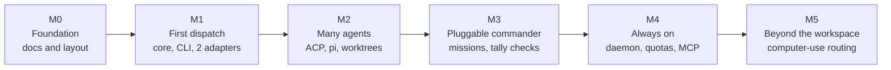

# Roadmap

| | |
|---|---|
| **Status** | Plan |
| **Last updated** | 2026-11-12 (Rust, both first adapters, M5 added) |
| **Related** | [Requirements](requirements/requirements.md), [Architecture](architecture/architecture.md) |

Milestones are ordered so that each one is useful on its own and none requires rewriting the one
before. Requirement ids (FR-xx) refer to the [requirements](requirements/requirements.md).

## M0. Foundation

**State: in progress (this is the current milestone).**

| Deliverable | Status |
|---|---|
| Requirements, research, architecture, technical design, deployment plan | Done in draft |
| Architecture decision records | Done in draft |
| Repository layout: `doc/` for documents, `src/` for code | Done |
| README in English and Chinese | Done |
| Implementation language | Decided: Rust ([ADR-0007](adr/0007-implement-in-rust.md)) |
| First adapters | Decided: Codex and Antigravity both ship in the first version |
| File-based job store ([ADR-0006](adr/0006-file-based-job-store.md)) | Proposed; waiting for the project owner |

**Exit:** the documents are reviewed and the remaining proposal is confirmed or replaced.

## M1. First dispatch

**Goal:** from Claude Code, hand a task to another agent, keep working, and collect the result
later, even from a different session.

| Deliverable | Requirements |
|---|---|
| Cargo workspace under `src/`, CI, release pipeline for prebuilt binaries, the `hufu` environment for cloud sessions | NFR-14 |
| Task spec and configuration schemas with validation | FR-01, FR-21, FR-47 |
| Job store, detached runner, heartbeat, timeouts, cancel, lost-job detection | FR-08, FR-11 to FR-13 |
| CLI: `run`, `status`, `wait`, `result`, `logs`, `cancel`, `resume`, `agents`, `doctor` | FR-02 to FR-07, FR-22, FR-43, FR-44 |
| Adapter contract and conformance suite with fake agents | FR-20 |
| Codex CLI adapter | FR-15 |
| Antigravity CLI adapter | FR-15 |
| Permission tiers and effort mapping for both adapters | FR-24 to FR-29 |
| Claude Code skill and `CLAUDE.md` snippet | FR-34 |

**Exit:** the durability test passes (a job outlives its caller and its result is read from a new
session), both adapters pass the conformance suite, and a live smoke test succeeds on a real
install of each agent.

**Both adapters are required for M1**; this was decided by the project owner. Codex is built first
because its interface is the better documented, and it shakes out the adapter contract; `agy`
follows inside the same milestone.

**Risks:** the `agy` non-TTY output bug, handled by closing stdin, treating empty output as a
failure and, if needed, running `agy` under a pseudo-terminal; and the open question about
subscription terms, which is documented for users and does not block building the adapter.

## M2. Many agents

**Goal:** one task spec reaches at least six agents, including a model on an open API.

| Deliverable | Requirements |
|---|---|
| Generic ACP adapter | FR-16 |
| Verified ACP profiles: Cursor, Kimi Code, pi (through `pi-acp`) | FR-17 |
| pi adapter with provider and model profiles for OpenRouter, DeepSeek, Z.ai and Kimi | FR-18 |
| Claude Code adapter | FR-19 |
| Git worktree isolation and same-directory write protection | FR-31, FR-33 |
| Structured output with schema validation | FR-09 |
| Job retention and pruning | FR-14 |

**Exit:** adding an unlisted ACP agent works from configuration alone, demonstrated with one agent
not named in this plan.

## M3. Pluggable commander

**Goal:** any profile can be the advisor. A mission runs from goal to report without a person in
the loop.

| Deliverable | Requirements |
|---|---|
| Mission engine: roster, plan request, plan validation, dependency-ordered dispatch | FR-35 to FR-37, FR-41 |
| Tally checks: command, paths, schema, advisor review | FR-38 |
| Review loop with accept, revise and abort; follow-ups on resumed sessions | FR-39 |
| Budgets: rounds, wall clock, tokens or cost | FR-40 |
| Mission inspection, pause and resume; mission report | FR-42 |
| Usage accounting per job and per mission | FR-49 |

**Exit:** the same goal completes with two different advisor profiles, one of them a model reached
through pi, with no code change between the runs.

## M4. Always on

**Goal:** Hufu becomes a service other tools can rely on.

| Deliverable | Requirements |
|---|---|
| Daemon with enforced concurrency limits, launchd and systemd units | FR-32, FR-46 |
| MCP shell | FR-45 |
| Retry policies | FR-10 |
| Plug-in adapters loaded from outside the package | FR-23 |
| Decision on Windows support | |

**Exit:** an MCP host other than Claude Code submits a job and reads its result.

## M5. Beyond the workspace

**Goal:** a task can use computer use, served either by a dedicated operator profile or by the
executor's own agent, chosen in configuration.

| Deliverable | Requirements |
|---|---|
| Survey of agents and runtimes that provide computer use, starting from the [LCU study](research/computer-use.md) | |
| Capability declaration on profiles; readiness in `hufu doctor` | FR-51, FR-57 |
| Routing: `executor` and `dedicated`, global and per task | FR-52 |
| Dedicated route: the `computer_use` tool, child jobs, parent links, budgets | FR-53 |
| Grants with an application scope; pre-flight; fail closed | FR-54, FR-55 |
| Display slot in the scheduler | FR-56 |

**Exit:** the same coding task completes a desktop step twice, once through the executor's own
agent and once through a dedicated operator, with only configuration changed between the runs.

**Depends on:** a machine the computer-use runtime supports. LCU, the reference runtime, does not
support Intel Macs.

## Later

Ideas that are deliberately not scheduled:

- Result delivery by push, for hosts that cannot poll.
- A read-only web view of jobs and missions.
- Sharing a roster and budgets across a team.
- Remote executors: dispatching to agents on another machine once ACP has a stable remote
  transport.
