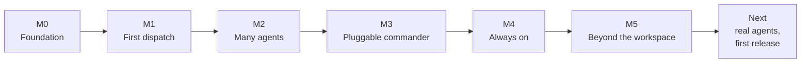

# Roadmap

| | |
|---|---|
| **Status** | M0 to M5 are implemented in Hufu 0.1, and Hufu can update itself from published releases. What remains is verification against real agents and the first stable release |
| **Last updated** | 2026-11-13 (`hufu update`; releases with prebuilt binaries, as pre-releases for now) |
| **Related** | [Requirements](requirements/requirements.md), [Architecture](architecture/architecture.md), [User guide](guide/user-guide.md) |

The milestones were planned so that each would be useful on its own. The project owner then asked
for the whole plan to be implemented at once, for all three platforms, so this document now
records what each milestone delivered and, more importantly, **how far each exit criterion has
actually been demonstrated**. Requirement ids (FR-xx) refer to the
[requirements](requirements/requirements.md).

## How "implemented" was checked

| Check | Result |
|---|---|
| End-to-end tests that drive the built `hufu` binary against built-in fake agents, one per adapter | Pass on Linux, macOS and Windows in CI |
| Adapter conformance suite, C1 to C12, for all eight adapters | Pass |
| Unit tests for parsers, mappings, configuration, schema validation, routing | Pass |
| `hufu doctor --self-test` on the built binary | Pass on the three platforms in CI |
| Formatting, lints (also for the Windows and macOS targets), minimum Rust version | Clean |
| Runs against real, logged-in agents | **Not done.** The development environment has no agent accounts |

The fake agents print what each agent's documentation says the real one prints. They prove that
Hufu's own machinery works; they cannot prove that a vendor's CLI still behaves as documented. That
is the open item under "Next".

## M0. Foundation

**State: done.** Requirements, research, architecture, technical design, decision records, the
repository layout and both READMEs. The file-based job store
([ADR-0006](adr/0006-file-based-job-store.md)) is what was built.

## M1. First dispatch

**State: implemented.**

| Delivered | Requirements |
|---|---|
| Cargo workspace under `src/`, CI on three platforms, release workflow for six targets, install scripts | NFR-14 |
| Task spec and configuration with validation; every problem reported at once | FR-01, FR-21, FR-47 |
| Job store, detached runner, heartbeat, timeouts, cancel of the whole process tree, lost-job detection | FR-08, FR-11 to FR-13 |
| CLI: `run`, `status`, `wait`, `result`, `logs`, `cancel`, `resume`, `agents`, `doctor` | FR-02 to FR-07, FR-22, FR-43, FR-44 |
| Adapter contract and conformance suite with fake agents | FR-20 |
| Codex CLI and Antigravity CLI adapters, with tier and effort mapping | FR-15, FR-24 to FR-29 |
| Claude Code skill and `CLAUDE.md` snippet, installed by `hufu setup` | FR-34 |

**Exit criteria.** The durability test passes (a job outlives its caller and its result is read by
another process). Both adapters pass the conformance suite. *Open:* the live smoke test on a real
install of each agent.

## M2. Many agents

**State: implemented.**

| Delivered | Requirements |
|---|---|
| Generic ACP adapter with a client written for Hufu; permission requests answered by tier | FR-16 |
| Preset profiles for Cursor and Kimi Code over ACP; headless adapters for Cursor and Kimi Code | FR-17 |
| pi adapter with provider and model profiles | FR-18 |
| Claude Code adapter | FR-19 |
| Third-party adapters as external programs speaking a small JSON protocol | FR-23 |
| Git worktree isolation; read-only enforcement by comparing the workspace before and after | FR-31, FR-33 |
| Structured output with schema validation | FR-09 |
| Job retention and pruning | FR-14 |

**Exit criteria.** An ACP agent that Hufu has no code for runs from configuration alone; this is
shown with the fake ACP agent. *Open:* the same with a real agent not named in this plan.

## M3. Pluggable commander

**State: implemented.**

| Delivered | Requirements |
|---|---|
| Mission engine: roster, plan request, plan validation, dependency-ordered and parallel dispatch | FR-35 to FR-37, FR-41 |
| Tally checks: command, paths, schema, denied actions, advisor review | FR-38 |
| Review loop with accept, revise and abort; follow-ups on resumed sessions | FR-39 |
| Budgets: tasks, rounds, wall clock, tokens or cost | FR-40 |
| Mission inspection, pause, resume, abort; mission report | FR-42 |
| Usage accounting per job and per mission, where agents report usage | FR-49 |

**Exit criteria.** Any profile can be the advisor; the tests run missions with different advisors
and executors without code changes. *Open:* the same goal completed by two real advisors, one of
them a model reached through pi.

## M4. Always on

**State: implemented.**

| Delivered | Requirements |
|---|---|
| Concurrency limits, global and per profile, enforced with and without the daemon | FR-32 |
| Optional daemon: ordered queue, restart of lost jobs, pruning | FR-46 |
| MCP server with 22 tools, including configuration tools | FR-45, FR-58, FR-59 |
| Retry policies | FR-10 |
| Several accounts per agent, pools with failover, round-robin and least-busy | FR-60 to FR-62 |
| One-command setup: `hufu up`, `hufu init`, `hufu setup` for five hosts; install scripts; an [install guide written for agents](guide/agent-install.md), found through `AGENTS.md` and `llms.txt` | FR-63, FR-64, FR-66 |
| Windows support | NFR-07 |

**Exit criteria.** An MCP client submits a job and reads its result; the tests do this with a
client of their own over stdio. *Open:* the same from a real host other than Claude Code.

Changed from the plan: the daemon is optional rather than required for limits and for MCP, and
Hufu does not install launchd or systemd units (the [deployment guide](deployment/deployment.md#6-run-modes)
shows how to run `hufu daemon run` under one).

## M5. Beyond the workspace

**State: implemented.**

| Delivered | Requirements |
|---|---|
| Capability declaration on profiles; readiness in `hufu doctor` | FR-51, FR-57 |
| Routing: `executor` and `dedicated`, in configuration and per task; any executor profile that supports computer use, or a profile kept for it | FR-52, FR-65 |
| Dedicated route: the `computer_use` hand-over tool, child jobs linked to their parent | FR-53 |
| Grants with an application scope; pre-flight against the runtime's allow-list; fail closed | FR-54, FR-55 |
| Display slot in the scheduler | FR-56 |

**Exit criteria.** The same task completes a desktop step through the executor's own agent and
through a dedicated operator, with only configuration changed; the tests show this with a fake
operator. *Open:* the same on a real desktop. LCU, the reference runtime, needs macOS on Apple
silicon, which no test machine of this project has.

## After M5: updates and releases

**State: implemented.**

| Delivered | Notes |
|---|---|
| `hufu update`, with `--check`, `--version`, `--from-source` and `--force` | Downloads a release, checks its SHA-256 sum, makes sure the new program starts, replaces the old one, restarts the daemon and runs `hufu doctor`. [ADR-0013](adr/0013-self-update-with-system-tools.md) |
| Releases with prebuilt binaries for six targets, their checksums and `hufu-manifest.json` | One workflow, started by hand or by a tag. Every release is checked on Linux, macOS and Windows before and after it is published |
| A dry run of the whole release on pull requests that touch it | The release path is tested before a release depends on it |

Versions are pre-releases (`0.1.0-alpha.N`) until live verification, below, is done: the binaries
are real, the adapters have not met real agents yet.

## Next

In order:

1. **Live verification.** Run each adapter against the real agent on a machine that has the
   logins: one read-only job, one writing job, one cancel, one resume. Record the agent version in
   the [agent landscape](research/agent-landscape.md) and fix what differs from the documentation.
2. **First stable release.** Set the version to `0.1.0` and run the release workflow. Until then
   the install scripts and `hufu update` serve the newest pre-release.
3. **Distribution channels.** crates.io, a Homebrew tap, an npm installer. Each needs an account or
   a name reserved by the maintainers.
4. **Computer use on a real desktop.** With LCU on Apple silicon, and with one agent's native
   computer use.

## Later

Ideas that are deliberately not scheduled:

- Result delivery by push, for hosts that cannot poll.
- A read-only web view of jobs and missions.
- Sharing a roster and budgets across a team.
- Remote executors: dispatching to agents on another machine once ACP has a stable remote
  transport.
- Service units installed by Hufu itself.
- A Windows job object around each agent, so that a process tree can be ended even after parents
  have exited.
